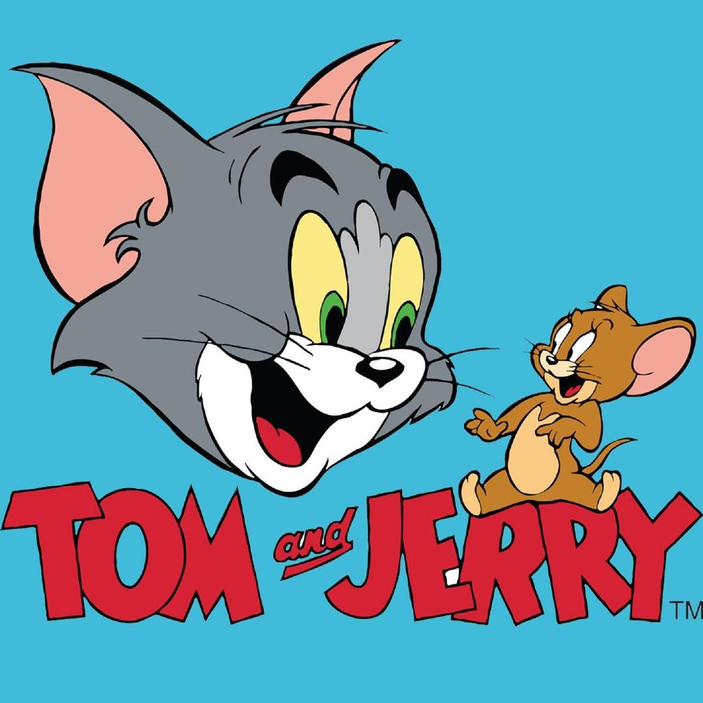
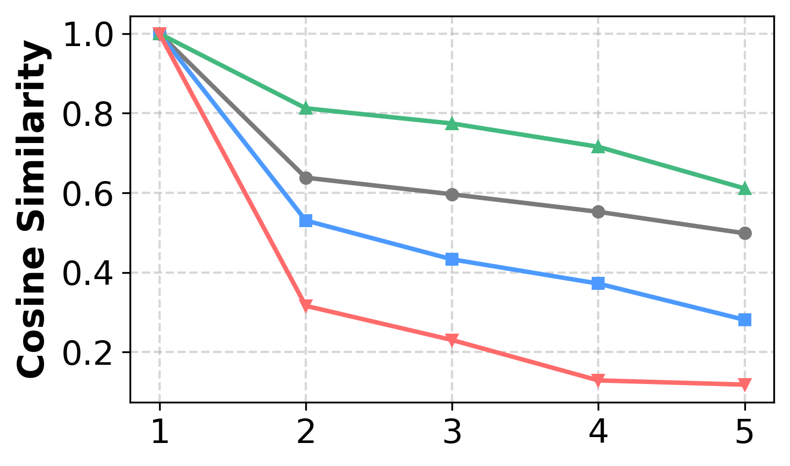
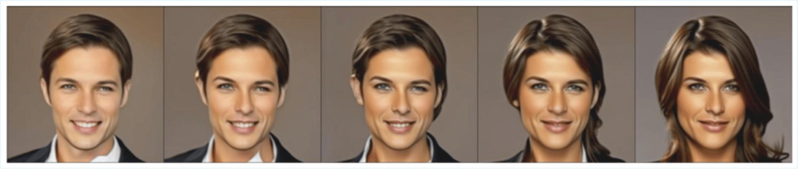
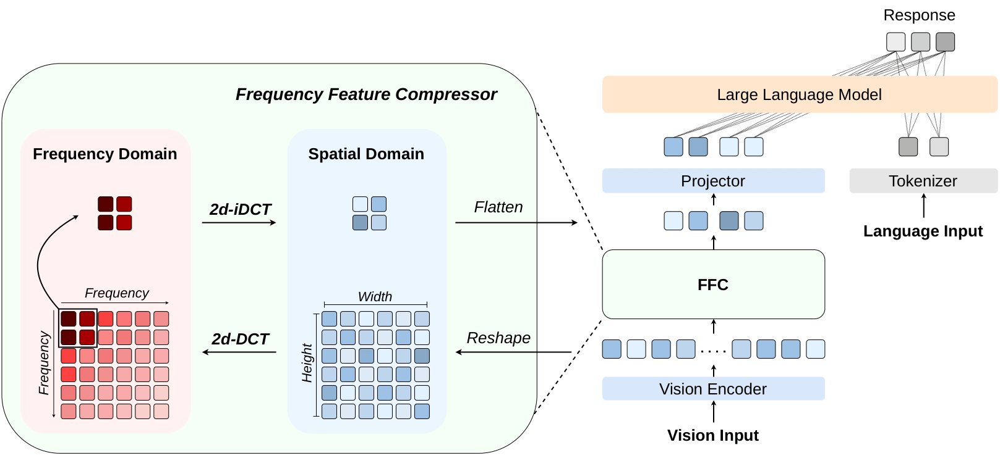

# Fourier Compressor - Frequency-Domain Visual Token Compression for VLMs
- **File:** `2508.06038v3.pdf`
- **Pages:** 15
- **Paper ID:** `2508.06038`

---

## Page 1

LUMIA Lab
Fourier Compressor: Frequency-Domain Visual
Token Compression for Vision-Language Models
Huanyu Wang1,4, Jushi Kai1,4, Haoli Bai3, Lu Hou3, Bo Jiang4, Ziwei He2,‡, Zhouhan Lin1,2,‡
1 LUMIA Lab, School of Artificial Intelligence, Shanghai Jiao Tong University
2 Shanghai Innovation Institute
3 Noah’s Ark Lab, Huawei Technologies Ltd.
4 School of Computer Science, Shanghai Jiao Tong University
#{whyisverysmart, lin.zhouhan}@gmail.com
‡ Corresponding Author.
§ https://github.com/whyisverysmart/Fourier-Compressor
Abstract
Vision-Language Models (VLMs) incur substantial computational overhead and inference latency due
to the large number of vision tokens introduced by high-resolution image and video inputs. Existing
parameter-free token compression methods typically rely on token selection or merging, yet they risk
discarding substantial visual information or distorting the original representation distribution, resulting
in pronounced performance degradation at high compression ratios. In response, we aim to explore
a more effective and efficient visual token compression strategy, with a promising direction in the
frequency domain. Motivated by the success of frequency-domain transforms in image compression
(e.g., JPEG), we systematically analyze the frequency redundancy in visual representations and uncover
a non-uniform distribution of semantic information across frequency bands. Building upon this, we
introduce Fourier Compressor, an effective, parameter-free, and highly generalizable module that
removes redundancy from visual representations within the frequency domain. Implemented via FFT
with O(𝑛2 log 𝑛) complexity and no additional parameters, Fourier Compressor introduces negligible
computational overhead while preserving semantic fidelity. Extensive experiments on image-based
benchmarks demonstrate that our method achieves a favorable performance-efficiency trade-off, retaining
over 96% of the original accuracy while reducing inference FLOPs by up to 83.8% and boosting generation
speed by 31.2%. It consistently outperforms existing parameter-free methods and even surpasses some
parameterized approaches. Importantly, Fourier Compressor generalizes consistently across both LLaVA
and Qwen-VL architectures, and further extends to video understanding tasks, highlighting its practical
applicability for efficient VLMs.
1. Introduction
Vision-Language Models (VLMs) extend Large Language Models (LLMs) with visual understanding
capabilities by integrating a vision encoder via a “glue layer” (e.g., Multi-Layer Perceptron or Q-
Former [Li et al., 2023a]) to jointly model visual and textual information. Nevertheless, the generation
of a large number of vision tokens imposes substantial computational demands, as the backbone LLM
must process an extremely long context, resulting in significant overhead and high inference latency.
For instance, LLaVA-v1.5 [Liu et al., 2024a] produces 576 visual tokens for a single 336 × 336 image,
while Qwen-VL series [Bai et al., 2025, Wang et al., 2024] generates one token per 28 × 28 pixels,
producing several thousand tokens for high-resolution images that often constitute the majority of
the input context, far exceeding the number of text tokens. This challenge is further amplified when
processing multiple images and video inputs.
Fortunately, visual representations in VLMs exhibit considerable redundancy, motivating the de-
arXiv:2508.06038v3  [cs.CV]  18 May 2026

---

## Page 2

Fourier Compressor
velopment of vision token compression. Existing parameter-free methods generally fall into two
paradigms. Approaches such as FastV [Chen et al., 2024a], ATP-LLaVA [Ye et al., 2025], and Sparse-
VLM [Zhang et al., 2024] rely on heuristic token selection, which risks discarding informative visual
content. Others, including VisionZip [Yang et al., 2025] and LLaVA-PruMerge [Shang et al., 2025],
adopt similarity-based token merging, inevitably perturbing the underlying visual representation
distribution. While being computationally efficient, both paradigms suffer pronounced performance
degradation under high compression ratios. Parameterized alternatives (e.g., VisToG [Huang et al.,
2024], QueCC [Li et al., 2024a], MQT-LLaVA [Hu et al., 2024]) mitigate these issues with learnable
queries, but incur additional compression-induced computational overhead. Extreme designs like
LLaVA-mini [Zhang et al., 2025b] introduce extra transformer blocks, resulting in substantial cost
and reduced architectural flexibility.
To address these limitations, we aim to develop a more effective, efficient, and generalizable vision
token compression strategy. One promising direction lies in the frequency domain. Frequency-
domain transforms have long been exploited in traditional image compression, where they reveal
substantial redundancy and enable highly efficient and generalizable compression methods (e.g.,
JPEG [Wallace, 1991]). Inspired by this, we systematically investigate whether similar frequency
redundancy exists in visual representations within VLMs. Our analysis in Section 3.2 confirms the
presence of such redundancy, uncovering a non-uniform distribution of semantic information across
frequency bands. This property can be directly exploited to design parameter-free token compression
strategies that are broadly applicable across different VLM architectures.
To this end, we introduce Fourier Compressor, an effective, parameter-free, and highly generalizable
module for compressing vision tokens in VLMs. By exploiting frequency-domain redundancy in visual
representations, our method achieves a favorable trade-off, significantly reducing token counts at high
efficiency while preserving generation performance. Fourier Compressor introduces no additional
parameters, resulting in minimal compression-induced computational overhead, and generalizes well
across multiple VLM architectures, offering an efficient and broadly applicable solution for vision
token compression.
The rest of this paper is organized as follows. Section 2 reviews related work. Section 3 presents
preliminaries on the Discrete Cosine Transform and the analyses of frequency components in visual
representations. Section 4 describes the detailed design and theoretical time complexity analysis
of our method. Section 5 presents performances on image-based benchmarks, evaluates empirical
efficiency, and demonstrates applicability to video tasks. Finally, Section 6 concludes the paper.
2. Related Work
2.1. Visual Token Compression in VLMs
Vision-Language Models (VLMs) have achieved remarkable progress in image and video understanding
by integrating LLMs with visual encoders. Despite strong performance from models like LLaVA
series [Liu et al., 2023, 2024a] and Qwen-VL series [Bai et al., 2025, Wang et al., 2024], the high
volume of vision tokens remains a major bottleneck for efficient inference and practical deployment.
To address the challenge of long contexts in VLMs, previous research has primarily focused on
reducing the number of vision tokens. One common approach involves selecting the most relevant
vision tokens or merging less important ones. For example, ATP-LLaVA [Ye et al., 2025] computes an
importance score for each vision token and dynamically determines a pruning threshold to remove
redundant tokens within the backbone LLM, while LLaVA-PruMerge [Shang et al., 2025] clusters
and averages vision tokens according to similarity between the class token and spatial tokens. Other
2

---

## Page 3

Fourier Compressor
methods leverage learnable parameters to extract visual features. MQT-LLaVA [Hu et al., 2024]
employs a Matryoshka Query Transformer, whereas QueCC [Li et al., 2024a] introduces a query-
based convolutional cross-attention module that enables text embeddings to query vision tokens.
Furthermore, recent research has also explored transferring visual information to language tokens,
such as LLaVA-mini [Zhang et al., 2025b], which employs a prefusion module that allows text tokens
to integrate relevant visual information in advance. However, these approaches have yet to find
an optimal balance between the additional computational cost of compression and performance
degradation. This challenge motivates us to further investigate cost-efficient token compression
methods.
2.2. Frequency-based Compression
Frequency domain techniques have long played an important role in signal processing and data
compression. In computer vision, frequency transformations are foundational to standard image
compression algorithms, such as JPEG [Wallace, 1991]. Previous study [Xu et al., 2020] has also
shown that convolutional neural networks (CNNs) exhibit a strong sensitivity to low-frequency
channels, revealing an inherent frequency bias in visual feature extraction. Beyond the vision domain,
frequency-based approaches have also been widely explored in natural language processing. For
instance, FNet [Lee-Thorp et al., 2022] replaces the self-attention mechanism in Transformer-like
encoders with frequency transformation, achieving comparable performance with significantly reduced
computational costs. Fourier-Transformer [He et al., 2023] applies frequency-domain truncation to
downsample hidden states in Transformer models for improved efficiency. More recently, FreqKV [Kai
et al., 2026] introduces a frequency-based key-value compression technique that effectively extends
the context window of LLMs. When it comes to VLMs, DocPedia [Feng et al., 2024] leverages DCT
coefficients extracted directly from RGB images to perform vision encoding, enabling higher input
resolutions for document understanding tasks. However, the potential of applying frequency-domain
techniques to visual-token-level representations remains largely unexplored.
3. Preliminaries
In this section, we introduce the preliminaries of our method, including the formulation of the Discrete
Cosine Transform (Section 3.1), and the analyses of frequency components in visual representations
that reveal semantic redundancy within the frequency domain (Section 3.2).
3.1. Discrete Cosine Transform
The Discrete Cosine Transform (DCT) is a linear invertible function Ψ: ℝ𝑛→ℝ𝑛that converts a
sequence of discrete real numbers from the spatial domain to the frequency domain. It exhibits strong
energy compaction properties, as most signal information (e.g., audio, image) tends to concentrate in
the low-frequency components after transformation. Among the various variants of DCT, we conduct
the most widely used type-II DCT.
Formally, for a real-valued sequence ⟨𝑥𝑖⟩= {𝑥0, 𝑥1, . . . , 𝑥𝑁−1}, the DCT transformation is given by:
𝑓𝑚= 𝛼𝑚
𝑁−1
∑︁
𝑖=0
𝑥𝑖· 𝜙𝑁(𝑚, 𝑖),
(1)
3

---

## Page 4

Fourier Compressor
(a) Cat
(b) Bird
(c) Anime
(d) Cakes
(e) Origami
(f) Avg.
Figure 1 | Heatmap visualization of the frequency spectra of visual representations computed by the
Qwen2-VL vision encoder. We consider only the magnitude, averaging the absolute values across
all hidden dimensions for each frequency component, which is then plotted on a logarithmic scale.
In (f), the upper and lower heatmaps show the averaged frequency spectra of raw images and their
corresponding visual representations from 10,000 sampled images in GQA, respectively.
where 𝑚∈{0, 1, . . . , 𝑁−1}. The basis function 𝜙·(·, ·) and the normalization factor 𝛼𝑚are defined as:
𝜙𝑁(𝑥, 𝑦) = cos
 𝜋
𝑁𝑥

𝑦+ 1
2

𝛼𝑚=


√︃
1
𝑁
if m = 0,
√︃
2
𝑁
otherwise.
(2)
The above transformation expresses ⟨𝑥𝑖⟩as a sum of orthogonal cosine functions at different frequen-
cies, where the coefficients represent the contribution of each frequency component.
Conversely, given the frequency representation ⟨𝑓𝑚⟩= { 𝑓0, 𝑓1, . . . , 𝑓𝑁−1}, the original sequence can be
recovered by the inverse Discrete Cosine Transform (iDCT):
𝑥𝑖=
𝑁−1
∑︁
𝑘=0
𝛼𝑘· 𝑓𝑘· 𝜙𝑁(𝑘, 𝑖)
(3)
3.2. Analyses of Frequency Components
To systematically investigate the potential frequency redundancy of visual representations and examine
the semantic information captured by different frequency bands, we conduct three complementary
analyses focusing on: (i) energy distribution, (ii) image perturbation, and (iii) semantic-continuous
morphing.
Energy distribution. For multiple images, we apply the two-dimensional Discrete Cosine Transform
(DCT) to the visual representations produced by the Qwen2-VL [Wang et al., 2024] vision encoder,
and compute the energy of each frequency component by averaging the absolute values across all
hidden dimensions. As shown in Figure 1, the energy of these visual representations exhibits a strong
concentration in low-frequency components across all hidden dimensions. The prominence of
this pattern varies across images of different types, suggesting that the frequency-domain energy
distribution inherently encodes structural and semantic information. Importantly, as illustrated
4

---

## Page 5

Fourier Compressor
in Figure 1f, the averaged frequency pattern of visual representations closely resembles that of
the corresponding raw images, which motivates our exploration of frequency-domain compression,
analogous to JPEG [Wallace, 1991], for designing more effective and efficient vision token compression
strategies.
Replace
Noise
Blur
Mask
Spatial
Full
Low
High
0.0
0.1
0.2
0.3
0.4
0.5
0.6
0.7
Cosine Similarity
Figure 2 | Cosine similarity of perturbed ver-
sus original visual representations for four
types of perturbation.
Image Perturbation. For a fixed input image, we
apply four types of perturbation: (a) Replace, where
a fraction of pixels are replaced with uniform pixel
values; (b) Noise, adding zero-mean Gaussian noise;
(c) Blur, applying Gaussian blurring; and (d) Mask,
randomly masking contiguous square regions up to
a target area. We extract the corresponding visual
representations using the Qwen2-VL [Wang et al.,
2024] encoder, which are then transformed into the
frequency domain via the two-dimensional Discrete
Cosine Transform (DCT). We compute the cosine sim-
ilarity between the perturbed and original images
for: spatial vision tokens, full frequency components,
and the low- (lowest 25%) and high- (highest 25%)
frequency components. As illustrated in Figure 2,
low-frequency components consistently demon-
strate higher robustness across all perturbation types, whereas high-frequency components exhibit
pronounced sensitivity, suggesting that low-frequency bands predominantly encode global image
structures rather than local appearance details.
Spatial
Frequency (Full)
Frequency (Low)
Frequency (High)
Figure 3 | Cosine similarity of visual repre-
sentations of morphing frames relative to the
leftmost image, for spatial tokens, full-, low-
(lowest 25%) and high- (highest 25%) fre-
quency components.
Semantic Morphing. We employ a morphing se-
quence from FreeMorph [Cao et al., 2025], which
exhibits smooth and continuous semantic transitions.
Following the same protocol, we compute the cosine
similarity between the visual representations of each
morphing frame and that of the first (leftmost) im-
age. As shown in 3, low-frequency components ex-
hibit substantially greater stability under smooth
semantic transitions with consistent global struc-
ture (e.g., frontal pose and facial topology), whereas
high-frequency components undergo markedly larger
variations, further highlighting their distinct roles in
semantic encoding.
Conclusion. These results reveal a clear functional
separation across frequency bands and uncover sub-
stantial redundancy in the frequency domain of vi-
sual representations: Low-frequency components
predominantly capture global, coarse-grained seman-
tic attributes, exhibiting strong robustness to perturbations and smooth transitions under semantic
changes, and consequently dominate the overall energy distribution; In contrast, high-frequency
components are more sensitive to noise and primarily encode fine-grained details. This observation
indicates substantial semantic redundancy in visual representations, providing strong empirical moti-
vation for our frequency-domain token compression strategy, which selectively preserves low-frequency
information to achieve efficient token reduction while maintaining semantic fidelity.
5

---

## Page 6

Fourier Compressor
Fourier Compressor
Fourier Compressor
Figure 4 | Illustration of Fourier Compressor. After passing through the vision encoder, visual features
are reshaped into a grid and transformed into the frequency domain. Darker colors indicate larger
frequency magnitudes, while lighter colors represent smaller magnitudes. Only the low-frequency
components are retained and subsequently converted back to the spatial domain, serving as the
compressed visual features.
4. Method
In this section, we introduce Fourier Compressor, a parameter-free and highly generalizable module
for visual token compression. Building upon a standard VLM architecture, our framework preserves
the vision encoder, projector, and backbone LLM, and inserts the Fourier Compressor after the vision
encoder to substantially reduce the number of visual tokens. Below we detail the overall architecture
(Section 4.1), the design of the Fourier Compressor (Section 4.2), and the theoretical time complexity
analysis (Section 4.3).
4.1. General Architecture
The overall architecture of our framework is illustrated in Figure 4. The original vision input is first
preprocessed (e.g., resizing or cropping for images, frame extraction for videos) before entering the
vision encoder. The 3-channel resized image 𝑿𝑣∈ℝ𝑟×𝑟×3, where 𝑟represents the input resolution,
is initially passed through a CNN to extract low-level features, resulting in grid image features
ˆ𝑯
𝑣∈ℝ𝑁×𝑁×ℎ𝑐where 𝑁2 is the number of patches and ℎ𝑐is the output dimension of the CNN. These
grid features are then flattened and passed through a pretrained ViT, which encodes the visual
information into higher-level representations:
𝑯𝑣= 𝑉𝑖𝑠𝑖𝑜𝑛-𝐸𝑛𝑐𝑜𝑑𝑒𝑟(𝑿𝑣),
(4)
where 𝑯𝑣∈ℝ𝑁2×ℎ𝑣and ℎ𝑣is the output dimension of the vision encoder.
Subsequently, the visual features are processed by our Fourier Compressor, which reduces the number
of vision tokens from 𝑁2 to 𝐶2:
𝑯𝑣
𝑐= 𝐹𝑜𝑢𝑟𝑖𝑒𝑟-𝐶𝑜𝑚𝑝𝑟𝑒𝑠𝑠𝑜𝑟(𝑯𝑣),
(5)
where 𝑯𝑣
𝑐∈ℝ𝐶2×ℎ𝑣.
6

---

## Page 7

Fourier Compressor
Finally, the compressed visual features are passed through the projector to align with the text
embedding space, and processed alongside the text instructions by the backbone LLM, following the
typical VLM architecture.
4.2. Fourier Compressor
Algorithm 1 Fourier Compressor
1: Input: Image feature 𝐼of shape (𝐵, 𝑁2, ℎ𝑣)
2: Output: Compressed 𝐼𝑐of shape (𝐵, 𝐶2, ℎ𝑣)
3: 𝑋←Reshape(Transpose(𝐼, (1, 2)), (𝐵, ℎ𝑣, 𝑁, 𝑁))
4: 𝐹1 ←DCT(𝑋)
5: 𝐹2 ←DCT(Transpose(𝐹1, (2, 3)))
6: 𝐹←Transpose(𝐹2, (2, 3))
7: 𝐹𝑐←𝐹[:, :, : 𝐶, : 𝐶]
8: 𝑅1 ←IDCT(𝐹𝑐)
9: 𝑅2 ←IDCT(Transpose(𝑅1, (2, 3)))
10: 𝑌←Transpose(𝑅2, (2, 3))
11: 𝐼𝑐←Transpose(Reshape(𝑌, (𝐵, ℎ𝑣, 𝐶2)), (1, 2))
12: return 𝐼𝑐
Inside the Fourier Compressor, the original visual
features are first reshaped back to the grid size:
𝑮𝑣= 𝑅𝑒𝑠ℎ𝑎𝑝𝑒(𝑯𝑣),
(6)
where 𝑮𝑣∈ℝ𝑁×𝑁×ℎ𝑣. Then, a two-dimensional Dis-
crete Cosine Transform (2d-DCT) is applied along
the two spatial dimensions of size 𝑁to obtain the
frequency representation ˆ𝑭
𝑣. Formally:
ˆ𝑭
𝑣
𝑚,𝑛,: = 𝛼𝑚𝛼𝑛
𝑁−1
∑︁
𝑝=0
𝑁−1
∑︁
𝑞=0
𝑮𝑣
𝑝,𝑞,: · 𝜙𝑁(𝑚, 𝑝) · 𝜙𝑁(𝑛, 𝑞), (7)
where ˆ𝑭
𝑣∈ℝ𝑁×𝑁×ℎ𝑣and 𝜙·(·, ·), 𝛼𝑚are specified
in Equation 2. As analyzed in Section 3.2, low-frequency components capture more global and
semantically informative structures, which motivates the pruning of high-frequency components for
compression:
𝑭𝑣= ˆ𝑭
𝑣[0:𝐶, 0:𝐶, :],
(8)
where 𝑭𝑣∈ℝ𝐶×𝐶×ℎ𝑣and 𝐶2 is the number of preserved vision tokens.
Finally, we apply a two-dimensional inverse Discrete Cosine Transform (2d-iDCT) to reconstruct the
spatial features from the frequency-domain tokens:
𝑻𝑣
𝑖,𝑗,: =
𝐶−1
∑︁
𝑝=0
𝐶−1
∑︁
𝑞=0
𝛼𝑝𝛼𝑞· 𝑭𝑣
𝑝,𝑞,: · 𝜙𝐶(𝑝, 𝑖) · 𝜙𝐶(𝑞, 𝑗),
(9)
where 𝑻𝑣∈ℝ𝐶×𝐶×ℎ𝑣, which is then flattened to obtain the compressed image features:
𝑯𝑣
𝑐= 𝐹𝑙𝑎𝑡𝑡𝑒𝑛(𝑻𝑣) ,
(10)
where 𝑯𝑣
𝑐∈ℝ𝐶2×ℎ𝑣.
4.3. Time Complexity
A direct computation of the Discrete Cosine Transform (DCT) is inefficient, requiring O(𝑁2) operations
for an N-point sequence. However, by leveraging the Fast Fourier Transform (FFT) operator, we can
accelerate the DCT computation to O(𝑁log 𝑁), same for iDCT.
For a real-valued sequence of length N, denoted as ⟨𝑥𝑖⟩= {𝑥0, 𝑥1, . . . , 𝑥𝑁−1}, we first rearrange it by
separating the even- and odd-indexed elements and reversing the order of the odd-indexed elements.
If N is even, the reordered sequence ⟨𝑦𝑘⟩is defined as:
𝑦𝑘=
(
𝑥2𝑘
𝑘= 0, 1, . . . , 𝑁−2
2
𝑥2𝑁−1−2𝑘
𝑘= 𝑁
2 , . . . , 𝑁−1
(11)
7

---

## Page 8

Fourier Compressor
That is, ⟨𝑦𝑘⟩= {𝑥0, 𝑥2, . . . , 𝑥𝑁−2, 𝑥𝑁−1, 𝑥𝑁−3, . . . , 𝑥1}. A similar rearrangement applies when N is odd.
Next, we compute the FFT of ⟨𝑦𝑛⟩, yielding the sequence ⟨𝑧𝑚⟩:
⟨𝑧𝑚⟩= 𝐹𝐹𝑇(⟨𝑦𝑛⟩),
(12)
where ⟨𝑧𝑚⟩is a complex sequence of length N. The DCT coefficients can then be computed as:
𝑓𝑘= ℜ(𝑧𝑘) · cos
 𝑘𝜋
2𝑁

−ℑ(𝑧𝑘) · sin
 𝑘𝜋
2𝑁

,
(13)
where ℜ(·) and ℑ(·) denote the real and imaginary parts of a complex number, respectively.
For the two-dimensional DCT (2d-DCT) applied to a matrix 𝑿∈ℝ𝑁×𝑁, the transformation is equivalent
to performing a one-dimensional DCT along each row, followed by another one-dimensional DCT along
each column. Consequently, applying 2d-DCT to an 𝑁× 𝑁matrix results in a total time complexity of
O(𝑁2 log 𝑁).
Therefore, the Fourier Compressor, which first applies a 2d-DCT on the grid image features of size
𝑁× 𝑁× ℎ𝑣and then an 2d-iDCT on the compressed image features of size 𝐶× 𝐶× ℎ𝑣, has an overall
time complexity of:
O(N2 log N + C2 log C)
(14)
Table 1 | Time complexity of common mod-
ules processing inputs of shape (𝐵, 𝑁2, ℎ𝑣).
𝐶2 denotes the number of learnable queries.
Module
Time Complexity
MLP
O(𝐵· ℎ2
𝑣· 𝑁2)
Self-Attention
O(𝐵· ℎ𝑣· 𝑁4)
Query Transformer
O(𝐵· ℎ𝑣· 𝑁2 · 𝐶2)
Fourier Compressor
O(𝐵· ℎ𝑣· 𝑁2 log 𝑁)
Table 1 summarizes the time complexity of representa-
tive modules operating on inputs of shape (𝐵, 𝑁2, ℎ𝑣).
Under a typical regime where ℎ𝑣= O(103), 𝑁2 =
O(102), and 𝐶2 = O(10), our Fourier Compressor at-
tains the lowest theoretical complexity, substantially
outperforming attention-based (e.g., ATP-LLaVA [Ye
et al., 2025]) and query-based (e.g., MQT-LLaVA [Hu
et al., 2024]) compression methods in computational
efficiency. Empirical evaluations further validate this
efficiency advantage, as detailed in Section 5.4.
5. Experiments
In this section, we first describe the training strategy and evaluation settings (Section 5.1). Then
we present results on a wide range of image-based benchmarks (Section 5.2) and demonstrate
the generalizability of the Fourier Compressor across different VLM architectures (Section 5.3),
followed by empirical efficiency metrics (Section 5.4). Finally, we evaluate its applicability to video
understanding tasks (Section 5.5), highlighting its practical utility and broad applicability.
5.1. Experimental Setup
Since frequency-domain truncation inevitably alters the feature distribution, additional training
is required for the model to adapt to the compressed visual representations. Detailed training
configurations are provided in Table 2.
Fourier-LLaVA incorporates the Fourier Compressor into the LLaVA-v1.5 [Liu et al., 2024a] models.
Training follows the original two-stage protocol of the base model: first aligning compressed visual
features with the language embedding space, then optimizing for multimodal instruction following.
8

---

## Page 9

Fourier Compressor
Settings
Fourier-LLaVA
Fourier-Qwen
Stage 1
Stage 2
Trainable modules
Vision Encoder
✓
Projector
✓
✓
✓
LLM
✓
✓
Dataset
558k
665k
600k
Epochs
1
2
2
LoRA 𝑟/𝛼
-
128 / 256
-
Batch Size
256
256
128
Learning Rate
1e-3
2e-4
1e-6
MM LR
-
2e-5
1e-5
Vision LR
-
-
1e-6
Optimizer
AdamW
AdamW
Schedule
Cosine
Cosine
Warmup Ratio
0.03
0.03
Table 2 | Training configurations for Fourier-
LLaVA and Fourier-Qwen.
Fourier-Qwen incorporates the Fourier Compres-
sor into the Qwen-VL series [Bai et al., 2025, Wang
et al., 2024]. We perform continued finetuning on
600k single-image conversation samples from LLaVA-
NeXT [Liu et al., 2024b], inserting the compressor
after the original MLP-based merger.
We evaluate on eight image-based benchmarks cov-
ering VQA, domain knowledge, and text recogni-
tion [Goyal et al., 2017, Hudson and Manning, 2019,
Li et al., 2023b, Liu et al., 2023, 2024c, Lu et al.,
2022, Singh et al., 2019, Yue et al., 2024]. For the
Fourier-Qwen series, three additional benchmarks
are included [Chen et al., 2024b, Fu et al., 2023, xAI,
2024]. We primarily use lmms-eval [Zhang et al.,
2025a] for evaluation.
For benchmarks not sup-
ported by lmms-eval (VQAT, MMB, and LLaVAW),
we follow the official scripts from LLaVA-v1.5. For
LLaVAW, performance is measured with gpt-4-0613
at temperature 0.2.
5.2. Image Benchmark Performance
We begin by evaluating the effectiveness of the proposed Fourier Compressor on image-based mul-
timodal benchmarks. Specifically, we integrate the compressor into the LLaVA-v1.5 backbone and
systematically vary the number of preserved vision tokens from 36 to 256.
Table 3 presents the results on eight image benchmarks. Notably, even with a reduced number
of vision tokens, Fourier-LLaVA achieves competitive results. With 256 vision tokens (44% of the
original tokens), Fourier-LLaVA achieves superior performance to the vanilla LLaVA-v1.5-7B on four
benchmarks. Moreover, with just 144 vision tokens (25% × 576), it still surpasses the base model in
terms of average score. Even at the lowest setting of 36 vision tokens (6.25% of the original tokens),
Fourier-LLaVA only exhibits a 3.87% drop in average, while continuing to outperform the base model
on SciQA and MMB.
For other token compression approaches, we compare the performance under the same number of
vision tokens. Note that all the methods mentioned are implemented based on LLaVA-v1.5 series
and require a two-stage training process. Generally, Fourier-LLaVA outperforms prior parameter-
free methods such as ATP-LLaVA and LLaVA-PruMerge across nearly all benchmarks at the same
vision token count, substantially improving generation performance under high compression ratios.
Furthermore, it surpasses MQT-LLaVA, which relies on additional learnable parameters, achieving a
2.2% increase in average scores, further demonstrating the effectiveness of our approach.
Moreover, when scaled to a 13B backbone, Fourier-LLaVA continues to outperform LLaVA-PruMerge
under the same vision token budget. Besides, with only 25% of the original vision tokens, our
approach incurs only a 2.1% drop in the average score compared to the base model.
Overall, these results demonstrate that our Fourier Compressor achieves superior performance when
compressing visual tokens for image inputs, maintaining strong robustness under aggressive token
compression. Besides, it also exhibits strong compression efficiency, as detailed in Subsection 5.4.
9

---

## Page 10

Fourier Compressor
Table 3 | Performance of Fourier-LLaVA on 8 image-based benchmarks. “#I" denotes the number of
vision tokens per image. All baseline results are reported from original papers, except MQT-LLaVA on
VQAT, which was not originally reported and is newly evaluated by us. Note that PruMerge is the
only baseline available in the 13B model setting.
Model
#I
VQAv2
GQA
SQA
VQAT
POPE
MMB
LLaVAW
MMMU
Avg.
LLaVA-v1.5-7B
576
78.5
62.0
66.8
58.2
85.9
64.3
65.4
35.3
64.6
Compression ratio: 55.6%
MQT-LLaVA [Hu et al., 2024]
256
76.8
61.6
67.6
53.2
84.4
64.3
64.6
34.8
63.4
Fourier-LLaVA
256
78.6
62.7
69.9
56.0
85.3
66.4
64.4
33.1
64.6
Compression ratio: 75.0%
ATP-LLaVA [Ye et al., 2025]
144
76.4
59.5
69.1
-
84.2
66.0
-
-
-
MQT-LLaVA [Hu et al., 2024]
144
76.4
61.4
67.5
52.6
83.9
64.4
61.4
34.4
62.8
Prumerge [Shang et al., 2025]
144
76.8
-
68.3
57.1
84.0
64.9
-
-
-
Fourier-LLaVA
144
77.7
61.7
69.0
54.7
85.0
65.6
67.8
35.3
64.6
Compression ratio: 88.9%
ATP-LLaVA [Ye et al., 2025]
88
73.3
56.8
67.2
-
82.6
64.7
-
-
-
MQT-LLaVA [Hu et al., 2024]
64
75.3
60.0
67.0
51.7
83.6
63.5
59.4
34.4
61.9
Fourier-LLaVA
64
76.3
60.4
69.3
52.6
85.3
64.7
63.1
34.4
63.3
Compression ratio: 93.75%
MQT-LLaVA [Hu et al., 2024]
36
73.7
58.8
66.8
50.4
81.9
63.4
59.6
34.4
61.1
PruMerge [Shang et al., 2025]
32
72.0
-
68.5
56.0
76.3
60.9
-
-
-
Fourier-LLaVA
36
74.9
59.5
69.0
51.0
84.0
64.3
61.1
32.8
62.1
LLaVA-v1.5-13B
576
80.0
63.3
71.6
61.3
85.9
67.7
72.5
36.4
67.3
Compression ratio: 75.0%
PruMerge [Shang et al., 2025]
144
77.8
-
71.0
58.6
84.4
65.7
-
-
-
Fourier-LLaVA
144
78.7
62.7
71.1
57.4
85.4
66.2
69.5
35.8
65.9
5.3. Generalization Across Architectures
To assess the generalizability of the Fourier Compressor beyond the LLaVA series, we further apply
it to Qwen2-VL-2B and Qwen2.5-VL-3B [Bai et al., 2025, Wang et al., 2024], and evaluate on six
image-based benchmarks. This evaluation examines whether frequency-domain compression remains
effective across different vision encoders, backbone LLMs, and input resolutions.
As shown in Table 4, our method consistently preserves strong performance under substantial token
reduction. With a 57.3% decrease in vision tokens, Fourier-Qwen2-VL-2B incurs only a marginal
1.6% drop in average performance, while even achieving improvements on MME, POPE, RWQA, and
MMB. Notably, on Qwen2.5-VL-3B, the compressed model surpasses the vanilla baseline by 2.1% on
average, demonstrating that token reduction does not necessarily compromise reasoning capability.
In particular, the 7.9% gain on RealWorldQA suggests that frequency-domain compression may help
suppress redundant or noisy visual components, benefiting real-world question answering tasks.
Overall, these results indicate that the effectiveness of the Fourier Compressor is not architecture-
specific. It generalizes robustly across model scales and input resolutions, maintaining or even
improving performance despite aggressive visual token compression.
10

---

## Page 11

Fourier Compressor
Table 4 | Performance of Fourier-Qwen series. “#I" denotes the average number of vision tokens per
image. We report the performance of all models using lmms-eval, with the number of visual tokens
standardized to 256 - 2304 for fair comparison.
Model Series
#I
Avg.
MME
VQAT
POPE
RWQA
MMB
MMS
Qwen2-VL-2B
Vanilla
553
66.8
1894.4
78.2
86.1
61.4
72.3
44.2
Fourier-
236
65.7
1917.1
75.4
86.5
61.6
72.6
43.3
-57.3%
-1.6%
+1.2%
-3.6%
+0.5%
+0.3%
+0.4%
-2.0%
Qwen2.5-VL-3B
Vanilla
553
71.1
2138.3
77.6
87.2
59.6
77.8
56.2
Fourier-
236
72.6
2110.8
76.1
87.8
64.3
76.8
55.3
-57.3%
+2.1%
-1.3%
-1.9%
+0.7%
+7.9%
-1.3%
-1.6%
576 tokens
(Vanilla)
256 tokens
144 tokens
64 tokens
36 tokens
50
55
60
65
70
75
80
85
90
Latency (ms)
84.4
73.3
68.3
63.4
63.1
68.4
63.6
58.7
58.1
LLaVA-v1.5
MQT-LLaVA
Fourier-LLaVA
KV Cache Size
50
100
150
200
250
300
KV Cache Size (MB)
312.5
152.5
96.5
56.5
42.5
31.2% Faster TTFT
86.4% Less KV Cache
Figure 5 | Latency and KV cache usage of Fourier-LLaVA under varying numbers of vision tokens.
5.4. Floating Point Operations and Latency
Table 5 | Floating Point Operations of
Fourier-LLaVA under varying numbers of
preserved vision tokens (#I).
Model
#I
FLOPs (T)
(%)
LLaVA-v1.5-7B
576
8.54
-
Fourier-LLaVA
256
4.30
49.6
144
2.81
67.1
64
1.75
79.5
36
1.38
83.8
Beyond effectiveness, a key advantage of the proposed
Fourier Compressor lies in its parameter-free design and
inherent computational efficiency due to its FFT-based im-
plementation, as discussed in Section 4.3. To empirically
validate that these theoretical advantages translate into
practical gains, we conduct a systematic evaluation of the
efficiency of Fourier Compressor.
We evaluate the FLOPs (Floating Point Operations) of
Fourier-LLaVA under varying numbers of vision tokens
using calflops on an RTX 4090 (24G) GPU. Additionally,
we measure the TTFT (Time to First Token) and KV cache
usage on an A100 (40G) GPU.
As illustrated in Table 5 and Figure 5, Fourier-LLaVA achieves a substantial reduction in computational
cost compared to LLaVA-v1.5-7B, reducing FLOPs by 83.8%. Furthermore, our method lowers KV
cache usage by 86.4% and improves inference speed by 31.2% in TTFT, outperforming other token
compression baselines such as MQT-LLaVA under equivalent visual token counts.
11

---

## Page 12

Fourier Compressor
Table 6 | Performance of Fourier-LLaVA and Fourier-Qwen on MVBench. “#V" denotes the average
number of visual tokens per video. We report the performance of baselines and our models using
lmms-eval. For fair comparison, when evaluating Fourier-Qwen series, the number of visual tokens
per frame is set to 256 - 384, and the maximum number of frames is 16.
Model
Size
#V
Avg.
Ac
Ob
Posi
Sc
Cou
At
Pose
Ch
Cog
VideoChatGPT
7B
356
32.7
32.1
40.7
21.5
31.0
28.0
44.0
29.0
33.0
30.3
Video-LLaMA
7B
40
34.1
34.4
42.2
22.5
43.0
28.3
39.0
32.5
40.0
29.3
Video-LLaVA
7B
4096
43.1
48.0
46.5
27.8
84.5
35.5
45.8
34.0
42.5
34.2
VideoChat
7B
4096
35.5
38.0
41.2
26.3
48.5
27.8
44.3
26.5
41.0
27.7
VideoChat2
7B
4096
51.1
61.3
57.3
23.0
88.5
40.5
51.3
49.0
36.5
47.0
LLaVA-v1.5
7B
2304
45.6
52.8
43.7
31.5
83.5
37.0
45.3
44.5
50.0
37.3
Fourier-LLaVA
7B
288
44.0
48.1
46.3
31.0
81.0
40.5
41.3
36.0
49.0
36.3
Δ vs. LLaVA-v1.5
-87.5%
-1.6
-4.7
+2.6
-0.5
-2.5
+3.5
-4.0
-8.5
-1.0
-1.0
Qwen-2-VL
2B
3193
61.4
68.5
65.7
44.8
90.5
60.8
65.3
53.5
59.0
47.8
Fourier-Qwen-2
2B
1328
59.8
67.7
63.3
40.0
88.5
55.5
64.8
51.0
57.0
50.2
Δ vs. Qwen-2-VL
-58.4%
-1.6
-0.8
-2.4
-4.8
-2.0
-5.3
-0.5
-2.5
-2.0
+2.4
Qwen-2.5-VL
3B
3193
65.2
68.3
67.7
48.8
91.0
63.0
75.0
51.5
75.5
56.0
Fourier-Qwen-2.5
3B
1328
62.9
67.2
65.7
48.5
90.5
54.8
70.5
47.5
66.0
57.5
Δ vs. Qwen-2.5-VL
-58.4%
-2.3
-1.1
-2.0
-0.3
-0.5
-8.2
-4.5
-4.0
-9.5
+1.5
These improvements highlight the efficiency of our parameter-free approach, distinguishing Fourier
Compressor from prior works that rely on attention-based reductions or learnable parameters, which
is crucial for enabling real-time deployment of VLMs on resource-constrained devices.
5.5. Applicability to Video Tasks
Although our method is primarily designed for visual token compression in image inputs, the proposed
Fourier Compressor is inherently model-agnostic and parameter-free, enabling zero-shot application
to video tasks. To demonstrate this extension capability, we evaluate both Fourier-LLaVA and Fourier-
Qwen models on MVBench [Li et al., 2024b], a comprehensive multi-modal video understanding
benchmark comprising 20 challenging tasks.
As shown in Table 6, our method leverages significantly fewer vision tokens while outperforming
various open-source VLMs. Specifically, Fourier-Qwen series achieves a 58.4% reduction in visual
tokens with only a 3.1% drop in average performance, while Fourier-LLaVA retains 96.5% of the
base model’s performance utilizing merely 12.5% of the video tokens, and still surpasses the base
model on the Object and Count tasks. This zero-shot capability in video understanding highlights
the efficiency and robustness of our method, and suggests promising directions for future work on
scaling frequency-aware compression to visual representations of video inputs.
6. Conclusion
In this paper, we propose Fourier Compressor, an efficient, effective, and highly generalizable
framework for vision token compression in Vision-Language Models. Motivated by the non-uniform
frequency distribution of semantic information, our method significantly reduces frequency-domain
redundancy from visual representations. Empirically, it achieves a favorable trade-off between
performance and efficiency: Without introducing any additional parameters, it preserves over 96%
12

---

## Page 13

Fourier Compressor
average accuracy across eight image-based benchmarks while retaining only 6.25% of the original
visual tokens, leading to a substantial reduction in FLOPs to 16.16% and an inference speedup of 31.2%.
Seamlessly integrated into both the LLaVA-v1.5 and Qwen-VL series, Fourier Compressor exhibits
strong generalization across model architectures, and further demonstrates promising performance
on video understanding tasks. These results collectively highlight a favorable trade-off between
computational cost and model performance, facilitating more efficient and scalable deployment of
VLMs in real-world scenarios.
References
Shuai Bai, Keqin Chen, Xuejing Liu, Jialin Wang, Wenbin Ge, Sibo Song, Kai Dang, Peng Wang, Shijie
Wang, Jun Tang, Humen Zhong, Yuanzhi Zhu, Mingkun Yang, Zhaohai Li, Jianqiang Wan, Pengfei
Wang, Wei Ding, Zheren Fu, Yiheng Xu, Jiabo Ye, Xi Zhang, Tianbao Xie, Zesen Cheng, Hang
Zhang, Zhibo Yang, Haiyang Xu, and Junyang Lin. Qwen2.5-VL Technical Report. arXiv preprint
arXiv:2502.13923, 2025.
Yukang Cao, Chenyang Si, Jinghao Wang, and Ziwei Liu. FreeMorph: Tuning-Free Generalized
Image Morphing with Diffusion Model. In Proceedings of the IEEE/CVF International Conference on
Computer Vision, pages 18111–18120, 2025.
Liang Chen, Haozhe Zhao, Tianyu Liu, Shuai Bai, Junyang Lin, Chang Zhou, and Baobao Chang.
An Image is Worth 1/2 Tokens After Layer 2: Plug-and-Play Inference Acceleration for Large
Vision-Language Models. In European Conference on Computer Vision, pages 19–35. Springer,
2024a.
Lin Chen, Jinsong Li, Xiaoyi Dong, Pan Zhang, Yuhang Zang, Zehui Chen, Haodong Duan, Jiaqi Wang,
Yu Qiao, Dahua Lin, et al. Are We on the Right Way for Evaluating Large Vision-Language Models?
In Advances in Neural Information Processing Systems, volume 37, pages 27056–27087, 2024b.
Hao Feng, Qi Liu, Hao Liu, Jingqun Tang, Wengang Zhou, Houqiang Li, and Can Huang. DocPedia:
Unleashing the Power of Large Multimodal Model in the Frequency Domain for Versatile Document
Understanding. Science China Information Sciences, 67(12):220106, 2024.
Chaoyou Fu, Peixian Chen, Yunhang Shen, Yulei Qin, Mengdan Zhang, Xu Lin, Jinrui Yang, Xiawu
Zheng, Ke Li, Xing Sun, et al. MME: A Comprehensive Evaluation Benchmark for Multimodal Large
Language Models. arXiv preprint arXiv:2306.13394, 2023.
Yash Goyal, Tejas Khot, Douglas Summers-Stay, Dhruv Batra, and Devi Parikh. Making the V in VQA
Matter: Elevating the Role of Image Understanding in Visual Question Answering. In Proceedings of
the IEEE Conference on Computer Vision and Pattern Recognition, pages 6904–6913, 2017.
Ziwei He, Meng Yang, Minwei Feng, Jingcheng Yin, Xinbing Wang, Jingwen Leng, and Zhouhan Lin.
Fourier Transformer: Fast Long Range Modeling by Removing Sequence Redundancy with FFT
Operator. In Findings of the Association for Computational Linguistics: ACL 2023, pages 8954–8966,
2023.
Wenbo Hu, Zi-Yi Dou, Liunian H Li, Amita Kamath, Nanyun Peng, and Kai-Wei Chang. Matryoshka
Query Transformer for Large Vision-Language Models. In Advances in Neural Information Processing
Systems, volume 37, pages 50168–50188, 2024.
Minbin Huang, Runhui Huang, Han Shi, Yimeng Chen, Chuanyang Zheng, Xiangguo Sun, Xin Jiang,
Zhenguo Li, and Hong Cheng. Efficient Multi-modal Large Language Models via Visual Token
Grouping. arXiv preprint arXiv:2411.17773, 2024.
13

---

## Page 14

Fourier Compressor
Drew A Hudson and Christopher D Manning. GQA: A New Dataset for Real-World Visual Reasoning
and Compositional Question Answering. In Proceedings of the IEEE/CVF Conference on Computer
Vision and Pattern Recognition, pages 6700–6709, 2019.
Jushi Kai, Yixuan Wang, Boyi Zeng, Haoli Bai, Bo Jiang, Ziwei He, and Zhouhan Lin. FreqKV: Key-Value
Compression in Frequency Domain for Context Window Extension. In The Fourteenth International
Conference on Learning Representations, 2026.
James Lee-Thorp, Joshua Ainslie, Ilya Eckstein, and Santiago Ontanon. FNet: Mixing Tokens with
Fourier Transforms. In Proceedings of the 2022 Conference of the North American Chapter of the
Association for Computational Linguistics: Human Language Technologies, pages 4296–4313, 2022.
Junnan Li, Dongxu Li, Silvio Savarese, and Steven Hoi. BLIP-2: Bootstrapping Language-Image
Pre-training with Frozen Image Encoders and Large Language Models. In International Conference
on Machine Learning, pages 19730–19742. PMLR, 2023a.
Kevin Y Li, Sachin Goyal, Joao D Semedo, and J Zico Kolter. Inference Optimal VLMs Need Fewer
Visual Tokens and More Parameters. arXiv preprint arXiv:2411.03312, 2024a.
Kunchang Li, Yali Wang, Yinan He, Yizhuo Li, Yi Wang, Yi Liu, Zun Wang, Jilan Xu, Guo Chen, Ping Luo,
et al. MVBench: A Comprehensive Multi-modal Video Understanding Benchmark. In Proceedings of
the IEEE/CVF Conference on Computer Vision and Pattern Recognition, pages 22195–22206, 2024b.
Yifan Li, Yifan Du, Kun Zhou, Jinpeng Wang, Wayne Xin Zhao, and Ji-Rong Wen. Evaluating Object
Hallucination in Large Vision-Language Models. In Proceedings of the 2023 Conference on Empirical
Methods in Natural Language Processing, pages 292–305, 2023b.
Haotian Liu, Chunyuan Li, Qingyang Wu, and Yong Jae Lee. Visual Instruction Tuning. Advances in
neural information processing systems, 36:34892–34916, 2023.
Haotian Liu, Chunyuan Li, Yuheng Li, and Yong Jae Lee. Improved Baselines with Visual Instruction
Tuning. In Proceedings of the IEEE/CVF conference on computer vision and pattern recognition, pages
26296–26306, 2024a.
Haotian Liu, Chunyuan Li, Yuheng Li, Bo Li, Yuanhan Zhang, Sheng Shen, and Yong Jae Lee. LLaVA-
NeXT: Improved Reasoning, OCR, and World Knowledge. https://llava-vl.github.io/bl
og/2024-01-30-llava-next, 2024b.
Yuan Liu, Haodong Duan, Yuanhan Zhang, Bo Li, Songyang Zhang, Wangbo Zhao, Yike Yuan, Jiaqi
Wang, Conghui He, Ziwei Liu, et al. MMBench: Is Your Multi-modal Model an All-around Player?
In European Conference on Computer Vision, pages 216–233. Springer, 2024c.
Pan Lu, Swaroop Mishra, Tanglin Xia, Liang Qiu, Kai-Wei Chang, Song-Chun Zhu, Oyvind Tafjord,
Peter Clark, and Ashwin Kalyan. Learn to Explain: Multimodal Reasoning via Thought Chains for
Science Question Answering. In Advances in Neural Information Processing Systems, volume 35,
pages 2507–2521, 2022.
Yuzhang Shang, Mu Cai, Bingxin Xu, Yong Jae Lee, and Yan Yan. LLaVA-PruMerge: Adaptive Token
Reduction for Efficient Large Multimodal Models. In Proceedings of the IEEE/CVF International
Conference on Computer Vision, pages 22857–22867, 2025.
Amanpreet Singh, Vivek Natarajan, Meet Shah, Yu Jiang, Xinlei Chen, Dhruv Batra, Devi Parikh, and
Marcus Rohrbach. Towards VQA Models That Can Read. In Proceedings of the IEEE/CVF Conference
on Computer Vision and Pattern Recognition, pages 8317–8326, 2019.
14

---

## Page 15

Fourier Compressor
Gregory K Wallace. The JPEG Still Picture Compression Standard. Communications of the ACM, 34
(4):30–44, 1991.
Peng Wang, Shuai Bai, Sinan Tan, Shijie Wang, Zhihao Fan, Jinze Bai, Keqin Chen, Xuejing Liu, Jialin
Wang, Wenbin Ge, Yang Fan, Kai Dang, Mengfei Du, Xuancheng Ren, Rui Men, Dayiheng Liu, Chang
Zhou, Jingren Zhou, and Junyang Lin. Qwen2-VL: Enhancing Vision-Language Model’s Perception
of the World at Any Resolution. arXiv preprint arXiv:2409.12191, 2024.
xAI. RealWorldQA: A Benchmark for Real-World Understanding. https://huggingface.co/dat
asets/xai-org/RealworldQA, 2024.
Kai Xu, Minghai Qin, Fei Sun, Yuhao Wang, Yen-Kuang Chen, and Fengbo Ren. Learning in the
Frequency Domain. In Proceedings of the IEEE/CVF Conference on Computer Vision and Pattern
Recognition, pages 1740–1749, 2020.
Senqiao Yang, Yukang Chen, Zhuotao Tian, Chengyao Wang, Jingyao Li, Bei Yu, and Jiaya Jia.
VisionZip: Longer is Better but Not Necessary in Vision Language Models. In Proceedings of the
IEEE/CVF Conference on Computer Vision and Pattern Recognition, pages 19792–19802, 2025.
Xubing Ye, Yukang Gan, Yixiao Ge, Xiao-Ping Zhang, and Yansong Tang. ATP-LLaVA: Adaptive Token
Pruning for Large Vision Language Models. In Proceedings of the IEEE/CVF Conference on Computer
Vision and Pattern Recognition, pages 24972–24982, 2025.
Xiang Yue, Yuansheng Ni, Kai Zhang, Tianyu Zheng, Ruoqi Liu, Ge Zhang, Samuel Stevens, Dongfu
Jiang, Weiming Ren, Yuxuan Sun, et al. MMMU: A Massive Multi-discipline Multimodal Under-
standing and Reasoning Benchmark for Expert AGI. In Proceedings of the IEEE/CVF Conference on
Computer Vision and Pattern Recognition, pages 9556–9567, 2024.
Kaichen Zhang, Bo Li, Peiyuan Zhang, Fanyi Pu, Joshua Adrian Cahyono, Kairui Hu, Shuai Liu,
Yuanhan Zhang, Jingkang Yang, Chunyuan Li, et al. LMMs-Eval: Reality Check on the Evaluation
of Large Multimodal Models. In Findings of the Association for Computational Linguistics: NAACL
2025, pages 881–916, 2025a.
Shaolei Zhang, Qingkai Fang, Zhe Yang, and Yang Feng. LLaVA-Mini: Efficient Image and Video Large
Multimodal Models with One Vision Token. arXiv preprint arXiv:2501.03895, 2025b.
Yuan Zhang, Chun-Kai Fan, Junpeng Ma, Wenzhao Zheng, Tao Huang, Kuan Cheng, Denis Gudovskiy,
Tomoyuki Okuno, Yohei Nakata, Kurt Keutzer, et al. SparseVLM: Visual Token Sparsification for
Efficient Vision-Language Model Inference. arXiv preprint arXiv:2410.04417, 2024.
15

---
