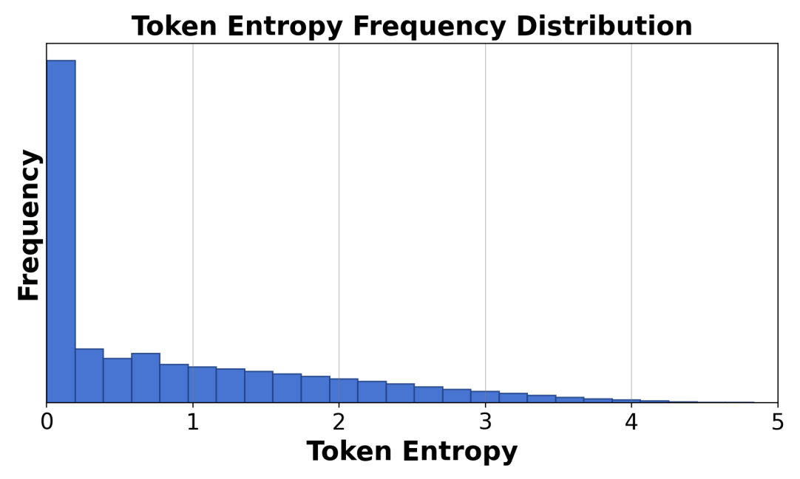
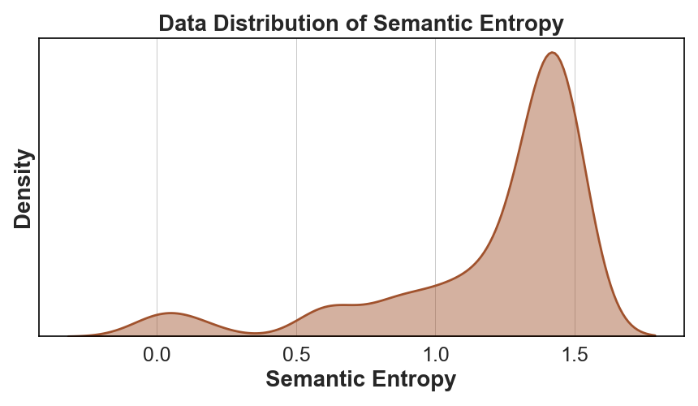
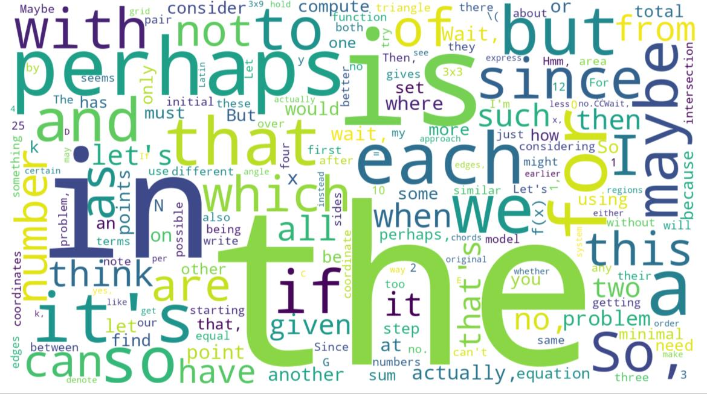
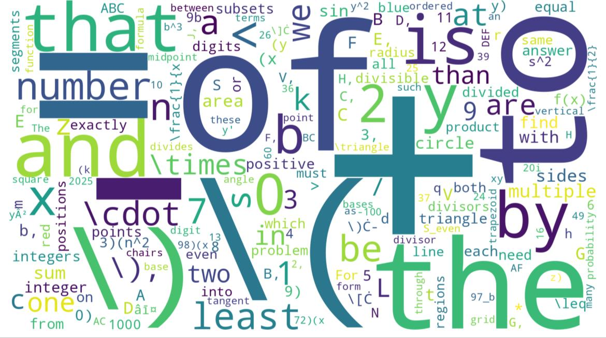

# Efficient Reinforcement Learning with Semantic and Token Entropy for LLM Reasoning
- **File:** `2512.04359v3.pdf`
- **Pages:** 21
- **Paper ID:** `2512.04359`

---

## Page 1

1
Efficient Reinforcement Learning with Semantic
and Token Entropy for LLM Reasoning
Hongye Cao , Zhixin Bai , Ziyue Peng , Boyan Wang , Tianpei Yang , Jing Huo ,
Yuyao Zhang, and Yang Gao , Senior Member, IEEE,
Abstract—Reinforcement
learning
with
verifiable
rewards
(RLVR) has demonstrated superior performance in enhancing the
reasoning capability of large language models (LLMs). However,
this accuracy-oriented learning paradigm often suffers from
entropy collapse, which reduces policy exploration and limits
reasoning capabilities. To address this challenge, we propose
an efficient reinforcement learning framework that leverages
entropy signals at both the semantic and token levels to improve
reasoning. From the data perspective, we introduce semantic
entropy-guided curriculum learning, organizing training data
from low to high semantic entropy to guide progressive optimiza-
tion from easier to more challenging tasks. For the algorithmic
design, we adopt non-uniform token treatment by imposing KL
regularization on low-entropy tokens that critically impact policy
exploration and applying stronger constraints on high-covariance
portions within these tokens. By jointly optimizing data organi-
zation and algorithmic design, our method effectively mitigates
entropy collapse and enhances LLM reasoning. Experimental
results across 6 benchmarks with 3 different parameter-scale
base models demonstrate that our method outperforms other
entropy-based approaches in improving reasoning.
Index Terms—Reinforcement learning, entropy, large language
models, reasoning, curriculum learning
I. INTRODUCTION
R
EASONING has emerged as a core capability of large
language models (LLMs) in tackling complex tasks [1],
[2]. Reinforcement learning with verifiable rewards (RLVR)
has effectively enhanced LLMs’ reasoning capabilities across
mathematics [3], [4], code generation [5], [6], and decision-
making applications [7]–[9] through post-training. However,
this purely accuracy-based learning paradigm decreases explo-
ration and may lead to local optima [10], [11], thereby limiting
the model’s ability to improve reasoning performance. This
problem manifests as precipitous entropy collapse during post-
training. Entropy, which quantifies uncertainty in the policy’s
action distribution and measures exploration capability [12]–
[14], drops sharply during training, resulting in generated
responses that lack diversity and further limiting exploration.
To encourage exploration and improve reasoning, prior
works have investigated entropy-guided strategies to enhance
Hongye
Cao,
Zhixin
Bai,
Ziyue
Peng,
Boyan
Wang,
Tianpei
Yang,
Jing
Huo,
and
Yang
Gao
are
with
the
National
Key
Laboratory
for
Novel
Software
Technology,
Nanjing
University,
Nanjing
210093,
China
(e-mail:
hongyecao528@gmail.com;
652024330001@smail.nju.edu.cn;
231220093@smail.nju.edu.cn;
boyanwang@nju.edu.cn;
tianpei.yang@nju.edu.cn;
huojing@nju.edu.cn;
gaoy@nju.edu.cn). (Hongye Cao and Zhixin Bai contributed equally to this
work.)
Yuyao Zhang is with China Mobile NineVerse Artificial Intelligence Tech-
nology (Beijing) Co., Ltd., and Institute of Artificial Intelligence, NineVerse,
Beijing 100032, China (e-mail: zhangyuyao@cmjt.chinamobile.com).
0
50
100
150
200
250
Training Steps
0.8
0.6
0.4
0.2
0.0
Pass@32
0.0
0.3
0.6
0.9
1.2
Entropy
GRPO
GRPO + Entropy
Ours
Fig. 1.
Learning curves in entropy and Pass@32 during training of SENT
compared with GRPO and GRPO with entropy. The shadow is the derivation
of the performance of Pass@32 in AIME24 [19] benchmark.
LLMs’ reasoning. These approaches employ various tech-
niques, including dynamic temperature coefficient adjustment
based on entropy changes [15], introduction of novel reward
signals for optimization [11], [16], suppressing tokens that
contribute most to entropy decline [17], and masking low-
entropy tokens [18].
While these approaches have shown promising results, they
suffer from critical limitations that constrain reasoning. As
shown in Fig. 1, GRPO [5] experiences entropy collapse
that diminishes exploration capacity, whereas the method
that directly incorporates an entropy-maximization objective
encounters entropy explosion, resulting in policy instability.
These limitations fundamentally arise from entropy fluctua-
tions that destabilize policy learning and manifest through
three key issues: First, existing methods [11], [17], [18] focus
on local token-level entropy characteristics within individual
samples while neglecting the global perspective of training
data organization. The difficulty distribution of training sam-
ples significantly influences optimization and entropy changes,
yet existing works treat all samples equally regardless of their
semantic complexity, leading to abrupt difficulty transitions
that trigger unstable exploration performance. Second, at the
algorithmic level, most approaches [15], [16] apply uniform
optimization strategies across all tokens without distinguishing
their varying impacts on policy exploration. This one-size-fits-
all approach fails to recognize that low-entropy tokens, which
arXiv:2512.04359v3  [cs.AI]  16 Jan 2026

---

## Page 2

2
directly constrain exploration, require targeted intervention
distinct from high-entropy tokens. Third, current approaches
lack fine-grained control within tokens. Even among low-
entropy tokens, different portions exhibit varying degrees of
entropy changes, but existing methods apply homogeneous
constraints without adapting to these internal variations. These
limitations result in suboptimal exploration strategies that not
only fail to comprehensively mitigate entropy collapse but
also cannot maintain stable improvement in reasoning, thereby
failing to unlock the reasoning potential of LLMs.
To address these challenges, we propose an efficient rein-
forcement learning (RL) framework that combines data-level
Semantic ENtropy with Token-level entropy optimization
(SENT) for enhancing LLM reasoning. SENT is motivated by
a fundamental insight: entropy collapse stems from both
inadequate data curriculum that fails to scaffold learning
complexity and token-level optimization strategies that
treat all positions uniformly, ignoring the heterogeneous
importance of different tokens in reasoning chains.
At the data level, we introduce curriculum learning guided
by semantic entropy (SE) that organizes training data progres-
sively from low to high entropy, creating a learning process
from simpler to complex reasoning tasks. This curriculum
design prevents premature convergence by progressively in-
creasing the difficulty of training data, allowing the model
to gradually adapt to more complex reasoning tasks. For
the algorithmic design, we propose that reasoning chains
exhibit inherent structural heterogeneity that low-entropy to-
kens, which represent near-deterministic decisions, critically
constrain the model’s exploration capacity and contribute to
entropy collapse. Rather than treating all tokens uniformly,
we identify low-entropy tokens and impose KL regularization
to prevent over-optimization at these parts. Importantly, we
further analyze the internal structure of low-entropy tokens
and apply stronger constraints specifically to high-covariance
portions within these tokens, where increased uncertainty
preservation yields the benefit of maintaining exploration. This
fine-grained constraint mechanism encourages targeted explo-
ration at positions that most critically affect policy diversity.
Through this dual-level optimization, SENT achieves sustained
exploration by combining semantic entropy-based data cur-
riculum that provides a structured difficulty progression with
fine-grained token-selective KL regularization that preserves
policy diversity at critical decision points, thereby enabling
stable reasoning improvement during training.
The main contributions of this work can be summarized:
• We highlight that enhancing reasoning capabilities re-
quires exploration-aware entropy-based strategies at both
the data organization and algorithmic optimization, and
we are the first to jointly optimize exploration at these
two levels for LLMs’ reasoning.
• We propose SENT that combines semantic entropy-based
curriculum learning at the data-level with token-level low
entropy optimization. SENT organizes training data from
low to high semantic entropy, and applies KL regulariza-
tion on low-entropy tokens with stronger constraints on
their high-covariance portions to encourage exploration.
These two levels work in tandem so that the curriculum
provides stable difficulty scaffolding while token-level
constraints encourage exploration.
• We conduct extensive experiments across 6 benchmarks
on 1.5B, 7B, and 14B base models, demonstrating that
SENT outperforms existing entropy-based approaches and
effectively mitigates entropy collapse while enhancing
LLMs’ reasoning performance.
The remainder of this paper is organized as follows. Sec-
tion II provides an overview of related works, including RL
for LLMs, and entropy-based exploration in LLMs. Section III
details the necessary preliminaries. Section IV presents the
proposed approach in detail. In section V, we introduce
the experiments conducted to demonstrate the superiority of
SENT. Finally, section VI draws conclusions and discusses
future works.
II. RELATED WORK
A. Reinforcement Learning for LLMs
With the rapid development of LLMs, reinforcement learn-
ing with human feedback (RLHF) has been widely adopted
for aligning models with human preferences [20], [21]. Pi-
oneering works such as InstructGPT [20] and Constitutional
AI [22] demonstrated the effectiveness of RLHF in improving
helpfulness, harmlessness, and honesty of language models.
These methods typically employ PPO [23] with reward models
trained on human preference data to guide policy learn-
ing. Following the introduction of OpenAI’s o1 reasoning
model [24], RLVR has emerged as a promising paradigm
for enhancing reasoning capabilities in LLMs, particularly in
mathematics and programming domains [5], [25], [26]. Unlike
RLHF which relies on human preferences, RLVR leverages
automatic verification of solutions through test cases or formal
proofs, providing more reliable and scalable training signals.
This breakthrough has sparked the development of numerous
reasoning models, including DeepSeek R1 [2], QwQ [27],
and Qwen3 [28]. DeepSeek R1 achieved substantial perfor-
mance improvements through the GRPO algorithm [5], which
addresses the computational challenges of traditional actor-
critic methods by using group-based advantage estimation.
Subsequently, DAPO [10] was proposed to address limitations
in GRPO by incorporating direct advantage computation,
followed by other RLVR methods such as VAPO [4] and
GSPO [29], all aimed at improving LLMs’ reasoning capa-
bilities through more efficient policy optimization strategies.
In this work, we adopt GRPO as our baseline to investigate
the reasoning capability of LLMs.
B. Entropy-Based Exploration in LLMs
Entropy, as a measure of uncertainty in probability distribu-
tions, has been widely recognized as a crucial signal for ex-
ploration in RL [13], [30], [31]. As noted in DAPO [10], when
using simple PPO or GRPO algorithms, rapid entropy collapse
is commonly observed, resulting in generated responses that
lack diversity and limiting the model’s exploration capac-
ity. Entropy-based methods have been extensively explored
in traditional decision-making tasks and have demonstrated
strong performance [32]–[36]. Building upon this foundation,

---

## Page 3

3
recent works have increasingly focused on entropy-guided
methods to enhance exploration in LLMs. Dynamic resource
allocation [15] introduces mechanisms such as dynamic rollout
budget allocation and temperature scheduler, which adap-
tively allocate sampling resources based on task difficulty
and dynamically adjust sampling temperature to encourage
exploration. Token-level covariance analysis [17] reveals that
policy entropy changes are proportional to the covariance
between action probabilities and logit changes, leading to
methods that randomly prune high-covariance tokens. Beyond
the 80/20 rule [18] identifies that high-entropy tokens play
critical roles in reasoning paths and proposes policy gradi-
ent updates using only these tokens. Advantage reweighting
approach [16] dynamically assigns advantage weights based
on each token’s advantage and entropy to balance exploration
and exploitation. Entropy-augmented optimization [11] adds a
clipped and gradient-detached entropy term to the advantage
function in PPO and GRPO, encouraging longer and deeper
reasoning chains under high uncertainty while preserving the
original policy optimization direction. Despite these advances,
existing entropy-based methods predominantly operate at in-
dividual token level. Moreover, they focus primarily on algo-
rithmic optimization while neglecting the role of training data
organization in entropy dynamics. Our work addresses these
limitations by proposing a framework that jointly optimizes
entropy signals at both the data level and the token level.
III. PRELIMINARY
A. Group Relative Policy Optimization (GRPO)
GRPO is an extension of PPO to stabilize policy updates
by normalizing advantage estimates over groups of samples.
The key innovation is improving the robustness of policy
gradients by reducing variance through group-based advantage
computation, thereby eliminating the need for a separate value
network. The standard PPO objective is defined as:
JPPO(θ) = E(q,a)∼D,o∼πθold(·|q)
min [rt(θ)At, clip(rt(θ), 1 −ϵ, 1 + ϵ)At] ,
(1)
where D is the dataset of queries q and corresponding ground-
truth answers a, ϵ ∈R is a hyperparameter set to 2.0, and At
is the advantage calculated by a value network at timestep
t. The likelihood ratio for given question q and output o is
expressed below:
rt(θ) =
πθ(ot|q, o<t)
πθold(ot|q, o<t).
(2)
Building on the clipped objective in Eq. 1, GRPO eliminates
the value network by estimating advantages using the average
reward within a group of sampled responses. Specifically,
for each query q and its ground-truth answer a, the rollout
policy πθold generates a group of responses {oi}G
i=1 with
corresponding outcome rewards {Ri}G
i=1, where G ∈R is
the group size. The estimated advantage ˆAi
t is computed as:
ˆAi
t = ri −mean({Ri}G
i=1)
std({Ri}G
i=1)
,
(3)
where Ri =
(
1.0
if equivalent(a, oi)
0.0
if otherwise
.
Moreover, GRPO incorporates a KL divergence penalty to
constrain policy updates and prevent the trained policy from
deviating excessively from the reference policy. Hence, the
GRPO objective is:
JGRPO(θ) = E(q,a)∼D, {oi}G
i=1∼πθold(·|q)
"
1
G
G
X
i=1
1
|oi|
|oi|
X
t=1

min
ri
t(θ) ˆAi
t, clip(ri
t(θ),
1 −ϵ, 1 + ϵ) ˆAi
t

−βDKL(πθ ∥πref)
#
,
(4)
where πref is the reference model, which is usually the initial
supervised fine-tuning (SFT) model, and β is the coefficient
for the penalty.
B. Entropy Calculation
Policy entropy quantifies the uncertainty or randomness in
the action distribution of a policy. Given a policy model πθ,
for each token ot in an output o, the entropy of the current
policy over the vocabulary V is:
Ht = −
X
v∈V
πθ(v|q, o<t) log πθ(v|q, o<t).
(5)
This entropy metric quantifies the uncertainty level of
the policy on the current training distribution and is widely
adopted in maximum entropy RL as a regularization term to
encourage exploration [13], [14], [37].
IV. APPROACH
As shown in Fig. 2, SENT comprises two components: (1)
semantic entropy-guided curriculum learning that computes
semantic entropy for each training query and organizes data
progressively from low to high entropy for structured difficulty
escalation (Section IV-A), and (2) token-level optimization
that identifies low-entropy tokens vulnerable to collapse and
applies adaptive KL regularization with stronger constraints
on high-covariance portions to encourage exploration (Sec-
tion IV-B). Then, we provide the theoretical analysis for
preventing entropy collapse (Section IV-C), and practical im-
plementation of SENT (Section IV-D).
A. Curriculum Learning with Data-Level Semantic Entropy
While existing token-level entropy methods address opti-
mization characteristics, they neglect the critical role of train-
ing data organization in shaping the global entropy changes.
The difficulty distribution of training samples fundamentally
influences the reasoning, while a well-structured curriculum
can guide the policy to progressively build reasoning ca-
pabilities while maintaining efficient exploration. Our key
insight is that organizing training data according to their
difficulty, measured by semantic entropy that can prevent
abrupt entropy drops and facilitate gradual adaptation
to increasingly complex reasoning tasks. This data-level
curriculum learning provides a complementary approach to
algorithmic optimization, addressing entropy collapse from a
global perspective rather than the local token level.

---

## Page 4

4
Curriculum data
design
Training data 𝓓
𝓓𝟏
𝓓𝟐
𝓓𝒏
…
GRPO
Token-level entropy
Model Optimization
low
high
(a) Curriculum learning with semantic entropy
Question 
Rollout
…
What
is
the
value
of
𝒙?
Given 𝒙𝟑= 𝟔𝟒
Semantic entropy
…
SE calculation
Curriculum design
𝑺𝑬(𝒒) = −෍
𝒌=𝟏
𝑲
𝒑𝒌𝒍𝒐𝒈𝒑𝒌
Input samples
…
Since 𝟒𝟑= 𝟔, the
value is 𝒙= 𝟒
Try 𝒙= 𝟑: 𝟑𝟑= 𝟐𝟕,
try 𝒙= 𝟒: 𝟒𝟑= 𝟔𝟒,
𝒙= 𝟒
Take the square root of 
both sides gives 𝒙= 𝟖
high
low
entropy
Data Distribution
(b) Optimization with low-entropy tokens
…
Input
Original sequence x
Token-level 
entropy
…
Filter
Low entropy tokens
Covariance w/ low 
entropy tokens
…
Constrain
High covariance tokens
Optimization 
objective
𝓗𝓽= −෍
𝒋=𝟏
𝑽
𝒑𝒕,𝒋𝐥𝐨𝐠𝒑𝒕,𝒋
C𝐨𝐯𝒕= 𝐥𝐨𝐠𝒑𝒕−𝐥𝐨𝐠𝒑⋅𝑨𝒕−ഥ𝑨
𝓙𝐆𝐑𝐏𝐎𝜽−𝑬𝜷𝐜𝐨𝐧𝐊𝐋𝝅𝜽∥𝝅𝒓𝒆𝒇
Fig. 2. Overall framework of SENT with two components: (a) Curriculum learning with semantic entropy. (b) Optimization with low-entropy tokens.
1) Semantic Entropy: Unlike token-level entropy that mea-
sures uncertainty in individual token predictions, semantic en-
tropy quantifies the diversity of semantically distinct solutions
for a given problem [38], [39].
For a query q, semantic entropy evaluates whether different
generated responses convey the same underlying meaning,
even when expressed differently. This is formalized through
semantic equivalence classes: responses that are semantically
equivalent (meaning the same thing) are grouped together,
and the entropy is computed over these meaning clusters
rather than individual token sequences. High semantic entropy
indicates that the model generates diverse reasoning paths with
different solutions, suggesting the problem is challenging and
requires extensive exploration. Low semantic entropy indicates
the model consistently converges to the same solution, sug-
gesting the problem is relatively easier for the current policy.
We compute semantic entropy through a three-step process.
Response Generation: For each query q in the training
dataset D, we sample M responses from the current policy
πθ:
{o1, o2, . . . , oM} ∼πθ(·|q),
(6)
along
with
their
associated
probabilities
{P(o1|q), · · · , P(oM|q)}. In SENT, we use nucleus sampling
with temperature T = 1.0 to generate diverse responses that
reflect the model’s uncertainty distribution.
Semantic Clustering: We cluster the generated responses
into semantic equivalence classes based on their meanings. For
reasoning tasks with verifiable answers (e.g., mathematics),
we operate semantic equivalence through answer equivalence:
two responses oi and oj are semantically equivalent if they
yield the same final answer (e.g., the numerical result in math
problems). This partitions the M responses into K equivalence
classes C = {C1, C2, . . . , CK}, where each class Ci contains
responses that express the same meaning.
For each semantic cluster Ci, we compute its probability by
summing the probabilities of all responses in that cluster:
P(Ci|q) =
X
o∈Ci
P(o|q).
(7)
Entropy Calculation: We estimate the semantic entropy as
the entropy over the meaning distribution:
HSE(q) = −
K
X
i=1
P(Ci|q) log P(Ci|q),
(8)
to account for sampling limitations, we normalize the cluster
probabilities to form a proper probability distribution:
ˆP(Ci|q) =
P(Ci|q)
PK
j=1 P(Cj|q)
.
(9)
The final semantic entropy is then computed using these
normalized probabilities for Eq. 8.
This semantic entropy metric captures the intrinsic difficulty
of each query from the perspective of the training data:
queries with high semantic entropy exhibit diverse solution
distributions and require more exploration, while queries with
low semantic entropy show solution convergence and are
easier for the model.
2) Curriculum Design: Based on semantic entropy, we
design a progressive curriculum that organizes training data
from easy to hard.
Before training, we compute the semantic entropy HSE(q)
for each query q ∈D using the initial policy πθ (typically
the SFT model). This provides a difficulty profile of the entire
training dataset from the model’s perspective.
Then, we sort the training dataset in ascending order of
semantic entropy:
Dsorted = sort(D, key = HSE),
(10)

---

## Page 5

5
such that queries with lower semantic entropy (easier problems
with more consistent solutions) appear earlier, and queries with
higher semantic entropy (harder problems requiring diverse
exploration) appear later. Finally, we divide the sorted dataset
into N curriculum stages and train the policy progressively.
At stage n ∈{1, 2, . . . , N}, the model is trained on Dn. The
selection of stages N is analyzed in section V-C5.
This curriculum design prevents the model from encoun-
tering overly challenging problems prematurely, which would
cause aggressive policy updates and rapid entropy collapse.
By building reasoning capabilities on easier examples first, the
model maintains stable exploration while gradually adapting
to more complex reasoning tasks.
B. Optimization with Token-Level Entropy
Most existing methods apply uniform optimization strate-
gies across all token positions, treating each token equally
regardless of its impact on policy exploration. This uniform
approach has critical shortcomings: it fails to recognize that
different tokens play fundamentally different roles in the
reasoning process.
To prevent over-optimization at low-entropy positions, we
introduce token-selective KL regularization that applies con-
straints based on token-level entropy. Our key insight is
that low-entropy tokens are most vulnerable to entropy
collapse and require stronger regularization to encourage
exploration.
As demonstrated in [18], approximately 80% of low-entropy
tokens significantly influence the learning process for reason-
ing. However, while that work masks 80% of low-entropy
tokens during optimization, SENT takes a different approach:
instead of masking all low-entropy tokens which may lead to
instability, we apply targeted KL constraints on these tokens to
maintain stable exploration while preserving their contribution
to learning, with detailed comparison in section V-B. We
identify low-entropy tokens as:
Tlow = {ot | Ht(q, o<t) < τH},
(11)
where τH is the low entropy threshold.
Moreover, not all low-entropy tokens contribute equally
to entropy collapse. Following recent analysis [17], policy
entropy changes are proportional to the covariance between
action probabilities and their gradient magnitudes. This sug-
gests that within the low-entropy regime, tokens with high
covariance are particularly influential in entropy dynamics.
We compute the covariance for each low-entropy token ot ∈
Tlow as:
Covot∼πθ(·|q,o<t) =

log πθ(ot|q, o<t)−
1
N
N
X
j=1
log πθ(oj|q, o<j)

· (At −1
N
N
X
j=1
Aj),
(12)
where N is a batch of rollout tokens. For simplicity, we use
Covt to represent Covot∼πθ(·|q,o<t) in the later sections. This
formulation captures the correlation between the model’s con-
fidence (log probability) and the learning signal (advantage) at
each token. We identify high-covariance portions within low-
entropy tokens as:
Thigh-cov = {ot ∈Tlow | Covt > τcov},
(13)
where τcov is the threshold for high covariance across low-
entropy tokens. The selection of thresholds τcov and τH are
analyzed in section V-C6. Based on token-level entropy and
covariance analysis, we apply different KL constraints to
tokens according to their vulnerability to entropy collapse. For
each token ot, the KL coefficient βcon is determined by:
βcon =





βlow
if ot ∈Tlow \ Thigh-cov,
βhigh
if ot ∈Thigh-cov ⊆Tlow,
0
if ot /∈Tlow,
.
(14)
This fine-grained constraint mechanism ensures that regu-
larization strength is proportional to the token’s influence on
entropy changes.
Optimization Objective: Combining the data-level curricu-
lum with token-level selective regularization, the optimization
objective of SENT is:
JSENT(θ) = E(q,a)∼Dn, {oi}G
i=1∼πold(·|q)
"
1
G
G
X
i=1
1
|oi|
|oi|
X
t=1

min
ri
t(θ) ˆAi, clip(ri
t(θ), 1 −ϵ, 1 + ϵ) ˆAi
−βcon DKL(πθ ∥πref)
#
,
(15)
where Dn is the curriculum-stage dataset from Eq. 10, βcon
is the KL coefficient from Eq. 14, and other terms follow the
standard GRPO formulation.
C. Theoretical Analysis
In this section, we provide theoretical analysis for the
entropy changes of our SENT framework. Building upon [17],
we show how our token-selective KL regularization controls
entropy decline and maintains exploration capacity.
1) Entropy Changes: Following the theoretical framework
in [17], we establish how policy entropy evolves under our
token-level optimization. For softmax policies like LLMs,
the entropy change between consecutive training steps is
determined by the covariance between action log-probabilities
and logit changes.
Lemma 1 (Entropy changes [17], [40]). For a softmax
policy πθ, the entropy change given state s between two
consecutive steps k and k +1 under first-order approximation
satisfies:
H(πk+1
θ
) −H(πk
θ)
≈−Est
h
Covt
log πk
θ(ot|st), θk+1
st,ot −θk
st,ot
 i
,
(16)
where st = (q, o<t) denotes the state at position t, and θst,ot
denotes the output logit of (st, ot). θk+1
st,ot −θk
st,ot is the change
in the output logits between step k and step k +1. It indicates
that the change of policy entropy approximately equals the
negative covariance between log-probability of the action and
the change of logits.

---

## Page 6

6
Under Policy Gradient algorithms like GRPO, the logit
change is:
θk+1
s,o −θk
s,o = η · ∇θJ (θ).
(17)
Meanwhile, it is a common practice to use the Policy
Gradient algorithm [12] for gradient estimation:
∇J (θ) = Es∼Dn, ot∼πθ(·|s)
"
T
X
t=0
∇θ log πθ(ot|s)At
#
.
(18)
Proposition 1 (Logit Change in Policy Gradient [17], [41]).
When updating policy via Policy Gradient with learning rate
η, the logit difference satisfies:
θk+1
st,ot −θk
st,ot = η · πk
θ(ot|st)At.
(19)
Combining Lemma 1 and Proposition 1, we obtain:
Theorem 1 (Entropy Change under Vanilla Policy Gra-
dient [17], [40]). For Policy Gradient updates, the entropy
change satisfies:
H(πk+1
θ
) −H(πk
θ)
≈−η Est
h
Covt
log πk
θ(ot|st), πk
θ(ot|st)At
i
.
(20)
2) Token-Level KL Regularization: Now we analyze how
our token-level KL regularization affects entropy changes.
The optimization objective JSENT applies differentiated KL
coefficients βcon. By projecting the gradient to the logit space
and taking a first-order approximation, the logit update is:
θk+1
st,ot −θk
st,ot = η

πk
θ(ot|st)At−βcon ∇θDKL(πk
θ∥πref)

. (21)
We provide detailed derivation of Eq. 20 and 21 in the
Appendix.
Theorem 2 (Entropy Changes with Token-Level KL Regu-
larization). By combining Eq. 21 into Eq. 16, we can get the
entropy change based on Theorem 1 for state st satisfies:
H(πk+1
θ
) −H(πk
θ)
≈−Est
h
Covt
log πk
θ(ot|st), θk+1
st,ot −θk
st,ot
i
= −Est
h
Covt

log πk
θ(ot|st), η · ∇θJSENT(θ)
i
= −ηEst
h
Covt
log πk
θ(ot|st), πk
θ(ot|st)At
 i
|
{z
}
Term 1
+
ηEst
h
βcon Covt
log πk
θ(ot|st), ∇θDKL(πk
θ∥πref)
 i
|
{z
}
Term 2
.
(22)
Eq. 22 reveals how our token-selective KL regularization
controls entropy dynamics. The entropy change consists of
two terms:
Term
1:
Vanilla
Entropy
Decay.
The
first
term
−ηEst
h
Covt
log πk
θ(ot|st), πk
θ(ot|st)At
 i
is the standard en-
tropy change from Policy Gradient, which typically drives en-
tropy collapse. This covariance term is predominantly positive
during training (high-probability tokens with high advantages),
leading to monotonic entropy decrease.
Term 2: KL-Induced Entropy Preservation. The second
term ηEst
h
βcon Covt
log πk
θ(ot|st), ∇θDKL(πk
θ∥πref)
 i
rep-
resents the entropy-preserving effect of our KL regularization.
The KL term acts to pull the policy back toward the refer-
ence distribution, reducing the magnitude of policy updates.
Critically, this term has a positive contribution to entropy
change, counteracting the entropy collapse from Term 1. Our
hierarchical KL coefficient βcon provides differentiated entropy
control across token types:
Case 1: High-Entropy Tokens (ot /∈Tlow). For tokens with
Ht > τH, we set βcon = 0. These tokens already exhibit
sufficient exploration diversity, so no additional regularization
is needed. The entropy change follows the vanilla Policy
Gradient.
Case 2: Low-Entropy Tokens (ot ∈Tlow \ Thigh-cov). For
tokens with Ht < τH but moderate covariance, we apply
βcon = βlow. These near-deterministic tokens are vulnerable
to over-optimization. The moderate KL penalty slows entropy
decline.
Case 3: High-Covariance Low-Entropy Tokens (ot
∈
Thigh-cov ⊆Tlow). For tokens with both low entropy (Ht < τH)
and high covariance (Covt > τcov), we apply the strongest
KL regularization βcon = βhigh. According to Eq. 20, high
covariance indicates these tokens are most influential for
entropy collapse. The strong KL penalty provides maximal
entropy preservation.
Entropy Preservation. Since βhigh > βlow > 0, the KL-
induced preservation term is strongest where entropy collapse
is most severe. This hierarchical design ensures that:
• Targeted Intervention: Only vulnerable tokens (low-
entropy) receive regularization, avoiding unnecessary
constraints on exploratory (high-entropy) tokens.
• Covariance-Aware Prioritization: Within low-entropy
tokens, those with high covariance identified as primary
drivers of entropy collapse receives strongest constraints.
• Balanced Optimization: The interplay between entropy
decay (Term 1) and preservation (Term 2) maintains
H(πθ) ≥Hmin > 0 throughout training, unlike vanilla
where H(πθ) →0.
Unlike all-tokens entropy regularization (which applies
equal penalties to all tokens) or uniform covariance methods
(which treat all high-covariance tokens equally), SENT pro-
vides fine-grained control: we only intervene where entropy
collapse is most likely (low-entropy) and most impactful (high-
covariance), achieving entropy preservation with minimal in-
terference to the optimization process.
Combined with Curriculum Learning. The data-level
curriculum complements this token-level control by organizing
training samples from low to high semantic entropy. Easy
samples (low semantic entropy) allow the model to identify
stable low-entropy tokens that can safely converge, while
hard samples (high semantic entropy) require maintaining
diversity at more positions. Our token-level regularization
adapts to this curriculum progression, providing dynamic en-
tropy control throughout training. The curriculum component
adds an additional stabilization mechanism absent in existing
works, preventing entropy collapse from a complementary
data-organization perspective.
D. Practical Implementation

---

## Page 7

7
Algorithm 1 SENT
1: Input: Training dataset D, initial policy πθ, curriculum
stages N, sampling number M, thresholds τH, τcov
2: Output: Optimized policy πθ
// Curriculum design with semantic entropy
3: for each query q in D do
4:
Sample M responses {o1, . . . , oM} from πθ(·|q)
5:
C = {C1, . . . , CK}
6:
HSE(q) = −PK
i P(Ci|q) log P(Ci|q)
7: end for
8: Sort D by ascending HSE(q)
// Optimization with low-entropy tokens
9: for n = 1 to N do
10:
Initialize empty set Tlow, Thigh-cov
11:
for each (q, a) ∈Dn do
12:
for each token ot in response sequence do
13:
Compute token entropy Ht(q, o<t)
14:
if Ht < τH then
15:
Add ot to Tlow
▷Low entropy tokens
16:
end if
17:
end for
18:
for each ot in Tlow do
19:
Compute covariance Covt following Eq. 12
20:
if Covt > τcov then
21:
Add ot to Thigh-cov
▷High covariances
22:
end if
23:
end for
24:
for each token ot in response sequence do
25:
Set βcon following Eq. 14 ▷KL coefficient
26:
Update parameters θ following Eq. 15
27:
end for
28:
end for
29: end for
Algorithm 1 presents the complete training procedure for
our SENT framework. The algorithm integrates semantic
entropy-based curriculum learning at the data level with
token-selective KL regularization at the algorithmic level,
achieving synergistic exploration-aware optimization. First,
semantic entropy is computed for each query to quantify data
difficulty, and the training dataset is sorted accordingly to
form a progressive curriculum from easy to hard (lines 3-
8). During training, token-level entropy is used to identify
low-uncertainty tokens that are prone to collapse (lines 12-
17). Covariance between token probabilities and advantages is
further evaluated to detect highly influential tokens within low
entropy tokens (lines 18-23). Based on entropy and covariance,
adaptive KL regularization with coefficient βcon is applied,
imposing stronger constraints on stable but high-covariance
tokens while allowing flexible updates for others (lines 24-
27). This joint data-level and token-level mechanism enables
stable exploration and reasoning enhancement.
V. EXPERIMENT
Our experiments aim to address the following questions: (i)
How does the performance of SENT compare to other entropy-
guided approaches in diverse tasks. (ii) Can SENT, through
curriculum learning and token-level entropy optimization, mit-
igating entropy collapse and improving LLMs’ reasoning? (iii)
What are the effects of the components and hyperparameters
in SENT? (iv) What is the generalization performance in out-
of-distribution tasks? (v) What insights can be gained from
case studies of specific dialogues?
A. Experimental Setup
1) Benchmarks and Implementation Details: We conduct
training on different-sized base models, including: DeepSeek-
R1-Distill-Qwen-1.5B, Qwen2.5-Math-7B, and Qwen3-14B
on DAPO-MATH-17K datasets [10]. The rollout size M is
8, temperature factor is 1.0, max response length is 2048,
curriculum stage is 2, βhigh is 2, βlow is 0.5, and learning rate
η is 1e −6. For fair comparisons, we reproduce all baselines
and conduct training under the same hyperparameters in the
VeRL platform [42]. We select GRPO as our basic post-
training algorithm for applying entropy-guided methods. We
conduct extensive validation on six benchmarks, including
AIME 2025&2024 [19], AMC 2023 [43], MATH500 [44],
OlympiadBench [45], and Minerva [46]. We provide more
experimental details in the Appendix.
2) Baselines: We conduct comparison with baselines in-
cluding directly adding entropy into the learning objective [13]
(w/ En), adding an entropy-based advantage function [11] (w/
Adv), masking low-entropy tokens [18] (w/ Mask), clipping
a small fraction of high-covariance tokens [17] (w/ Clip) and
constrain high covariance tokens [17] (w/ Cov). Moreover, we
also compare with adding a high-entropy reward for optimiza-
tion (w/ High En) to validate the advantages of constraining
low-entropy tokens over encouraging high-entropy tokens.
3) Metrics: We assess the reasoning ability boundaries
using the Pass@K: represents at least one of K sampled
model outputs passes verification, and assess the average
performance using the Avg@K: denotes the average accuracy
over K evaluations, Len@K: average response length over K
evaluations per benchmark. We vary K across experiments to
ensure the statistical reliability of our evaluation results.
B. Main Results
1) Performance in 1.5B Base Model: We first analyze the
experimental results under the 1.5B base model, as shown
in Table I and II. We observe that SENT achieves the best
results in 17 out of 18 tasks. Notably, SENT obtains the best
average result of 68.57 across all tasks under the upper bound
metric of Pass@K, outperforming the second-best method
(GRPO w/ Mask) by 3.26 points. Furthermore, for the average
performance metric of Avg@K, SENT also achieves the best
results in 17 out of 18 tasks, attaining an average result of
44.01 across all 18 tasks. These results demonstrate that SENT
not only improves the upper bound of reasoning performance
but also achieves the best average performance. Meanwhile,
we observe that GRPO w/ high entropy reward fails to improve
model performance, whereas constraint-based approaches such
as GRPO w/ Mask and w/ Clip effectively enhance reasoning
capability. While directly maximizing entropy (w/ En) shows

---

## Page 8

8
TABLE I
PERFORMANCE COMPARISON ON SIX DATASETS UNDER DEEPSEEK-R1-DISTILL-QWEN-1.5B BASE MODEL. W/ MEANS WITH. ”PASS@K” REPRESENTS
AT LEAST ONE OF K SAMPLED MODEL OUTPUTS PASSES VERIFICATION. WE BOLD THE BEST SCORES AND UNDERLINE THE SUB-OPTIMAL RESULTS.
Benchmark
Metric
Base model GRPO [2] w/ En [13] w/ Adv [11]
w/ Mask [18] w/ Clip [17] w/ Cov [17]
w/ High En
w/ SENT
AIME24
Pass@8
40.00
40.00
60.00
53.33
56.67
46.67
43.33
46.67
63.33
Pass@16
43.33
50.00
60.00
56.67
63.33
46.67
53.33
60.00
70.00
Pass@32
43.33
56.67
70.00
53.33
73.33
70.00
53.33
53.33
76.67
AIME25
Pass@8
26.67
33.33
33.33
33.33
33.33
33.33
36.67
33.33
40.00
Pass@16
33.33
40.00
36.67
30.00
33.33
40.00
36.67
33.33
43.33
Pass@32
30.00
43.33
43.3
36.67
43.33
36.67
40.00
40.00
46.67
AMC23
Pass@8
80.00
87.50
90.00
90.00
90.00
92.50
92.50
85.00
92.50
Pass@16
87.50
95.00
90.00
92.50
92.50
92.50
90.00
92.50
95.00
Pass@32
92.50
95.00
97.50
95.00
95.00
90.00
97.50
95.00
97.50
MATH500
Pass@8
90.00
91.60
91.60
89.60
92.80
93.00
92.60
91.00
93.00
Pass@16
92.40
94.00
93.20
91.60
93.60
93.00
93.80
92.80
93.80
Pass@32
93.20
95.00
94.60
94.00
94.40
93.80
94.80
94.20
95.20
OlympiadBench
Pass@8
52.89
54.96
60.89
54.81
60.15
58.96
56.44
58.37
63.26
Pass@16
58.52
59.41
62.67
60.00
65.19
64.89
64.15
63.85
67.26
Pass@32
61.19
64.30
69.33
63.41
69.19
68.74
67.70
66.67
70.22
Minerva
Pass@8
33.82
32.72
34.56
34.56
34.93
33.09
36.76
34.56
37.50
Pass@16
36.76
36.03
41.91
37.13
38.97
38.60
40.44
41.18
42.65
Pass@32
41.54
39.71
45.59
40.44
45.59
44.49
43.01
45.22
46.32
Avg.
57.61
61.59
65.29
61.47
65.31
63.16
62.95
62.61
68.57
TABLE II
PERFORMANCE COMPARISON ON SIX DATASETS UNDER DEEPSEEK-R1-DISTILL-QWEN-1.5B BASE MODELS. W/ MEANS WITH. ”AVG@K” DENOTES THE
AVERAGE ACCURACY OVER K EVALUATIONS PER BENCHMARK. WE BOLD THE BEST SCORES AND UNDERLINE THE SUB-OPTIMAL RESULTS.
Benchmark
Metric
Base model GRPO [2] w/ En [13] w/ Adv [11] w/ Mask [18] w/ Clip [17]
w/ Cov [17] w/ High En w/ SENT
AIME24
Avg@8
18.33
14.17
22.50
21.67
23.33
23.33
19.17
19.58
27.92
Avg@16
18.96
16.46
20.62
19.58
24.79
22.50
21.67
21.25
25.21
Avg@32
18.54
15.63
22.29
19.58
24.79
24.27
20.52
18.96
26.56
AIME25
Avg@8
19.17
15.83
16.67
18.75
20.83
20.83
19.17
19.17
21.25
Avg@16
19.17
15.63
17.08
17.92
17.92
18.54
17.08
17.71
21.46
Avg@32
17.71
13.75
18.12
18.33
19.38
19.79
19.48
17.08
20.10
AMC23
Avg@8
57.81
56.25
65.62
60.31
70.00
64.49
60.94
60.00
71.56
Avg@16
57.03
60.47
63.75
56.41
68.28
67.03
65.94
62.97
70.16
Avg@32
57.58
58.12
65.47
58.12
69.61
65.23
64.38
64.69
70.00
MATH500
Avg@8
77.17
73.88
79.40
77.02
80.60
80.95
80.35
78.85
81.48
Avg@16
77.26
73.47
79.98
76.60
80.76
80.24
80.31
78.86
81.74
Avg@32
76.54
73.78
79.69
76.83
81.37
80.94
79.89
79.57
81.22
OlympiadBench
Avg@8
35.65
29.48
40.48
37.04
42.65
41.44
39.72
39.59
42.85
Avg@16
36.59
29.43
40.11
36.28
42.89
41.36
40.29
39.70
42.99
Avg@32
36.51
29.60
40.39
36.24
42.88
41.25
40.92
39.48
42.95
Minerva
Avg@8
18.38
17.65
20.13
19.03
21.14
20.27
20.40
19.62
21.90
Avg@16
18.22
16.93
20.86
18.36
21.25
20.96
20.63
20.38
21.25
Avg@32
18.89
16.97
20.98
18.84
21.19
20.66
20.62
20.38
21.53
Avg.
37.75
34.86
40.79
38.16
42.98
41.89
40.64
39.88
44.01
some advantages on the Pass@K metric, its average perfor-
mance remains unsatisfactory, demonstrating its instability.
In contrast, SENT not only improves the upper bound of
reasoning but also maintains stable average performance.
2) Performance in Different Base Models: To further val-
idate the effectiveness of SENT, we conduct additional ex-
periments on Qwen2.5-Math-7B, a larger-scale base model
with higher parameter capacity but without specialized rea-
soning function. As presented in Table III, SENT demon-
strates superior performance compared to all three baseline
methods, achieving the best results across all 6 benchmarks
for the Pass@16 metric. For the Avg@16 metric, our method
attains the best performance on 4 benchmarks and second-best
on Minerva benchmark. Notably, SENT achieves substantial
improvements over GRPO on Pass@16, indicating that our
approach effectively elevates the upper bound of the model’s
reasoning capability rather than merely optimizing within
existing performance constraints. The consistent improvements
observed across both the 1.5B and 7B base models provide
strong evidence for the effectiveness of SENT. These results
demonstrate that our entropy-guided learning paradigm scales

---

## Page 9

9
TABLE III
COMPARISON ON SIX BENCHMARKS UNDER Pass@16 AND Avg@16 USING 7B BASE MODELS. W/ MEANS WITH. WE BOLD THE BEST RESULTS AND
UNDERLINE THE SUB-OPTIMAL RESULTS. ∆MEANS THE DIFFERENCE BETWEEN THE RESULTS OF SENT AND SUB-OPTIMAL RESULTS.
AIME24
AIME25
AMC23
MATH500
OlympiadBench
Minerva
Method
Pass@16
Avg@16
Pass@16
Avg@16
Pass@16
Avg@16
Pass@16
Avg@16
Pass@16
Avg@16
Pass@16
Avg@16
Qwen2.5-Math-7B
GRPO
56.67
24.38
30.00
11.25
85.00
62.50
91.80
74.76
61.04
37.56
39.71
21.51
w/ En
60.00
25.42
36.67
11.67
90.00
66.56
91.00
75.07
61.17
37.33
38.24
21.62
w/ Mask
56.67
24.17
26.60
9.79
87.50
64.69
91.00
74.49
60.89
37.61
39.71
22.04
w/ SENT
66.67
30.63
50.00
19.79
95.00
69.22
92.00
73.83
67.11
38.00
40.07
21.76
∆
+6.67
+5.21
+13.33
+8.12
+5.00
+2.66
+0.20
-1.24
+5.94
+0.39
+0.36
-0.28
TABLE IV
COMPARISON ON SIX BENCHMARKS UNDER Pass@16 AND Avg@16 USING 14B BASE MODELS. W/ MEANS WITH. WE BOLD THE BEST RESULTS. ∆
MEANS THE DIFFERENCE BETWEEN THE RESULTS OF SENT AND GRPO RESULTS.
AIME24
AIME25
AMC23
MATH500
OlympiadBench
Minerva
Method
Pass@16
Avg@16
Pass@16
Avg@16
Pass@16
Avg@16
Pass@16
Avg@16
Pass@16
Avg@16
Pass@16
Avg@16
Qwen3-14B
GRPO
80.00
57.50
63.33
37.50
100
90.16
95.60
90.39
70.37
58.39
44.12
35.02
w/ SENT
86.67
65.62
83.33
48.96
100
93.75
100
93.75
73.33
61.46
45.22
35.34
∆
+6.67
+8.12
+20.00
+11.46
+0.00
+3.59
+4.40
+3.36
+2.66
+3.07
+1.10
+0.32
TABLE V
PERFORMANCE COMPARISON ON SIX BENCHMARKS ON Len@16. W/ MEANS WITH. WE BOLD THE BEST RESULTS. ∆MEANS THE DIFFERENCE BETWEEN
THE RESULTS OF SENT AND SUB-OPTIMAL RESULTS.
Method
AMIE24
AIME25
AMC23
MATH500
OlympiadBench
Minerva
Avg.
DeepSeek-R1-Distill
Qwen-1.5B
GRPO
4007.04
5464.50
2713.26
1410.54
1007.16
575.82
2529.72
w/ En
4217.96
4186.46
2974.16
2065.79
2944.22
2266.90
3109.25
w/ SENT
6020.88
5854.60
3707.48
2376.65
4006.52
2712.79
4113.15
∆
+1802.92
+390.10
+733.32
+310.96
+1062.30
+445.89
+1003.85
Qwen2.5-Math-7B
GRPO
1335.82
1282.48
887.77
712.33
912.59
749.84
980.14
w/ En
1354.60
1170.16
865.15
710.17
880.80
697.45
946.39
w/ SENT
1576.64
1387.50
1183.87
1146.48
1163.38
922.96
1230.14
∆
+222.04
+105.02
+296.10
+434.15
+250.79
+173.12
+250.00
effectively to larger model architectures and successfully en-
hances reasoning capabilities across different model scales.
Moreover, we compare our method with GRPO on Qwen3-
14B base model, with detailed results presented in Table IV.
SENT outperforms GRPO across all six benchmarks on both
metrics, demonstrating the effectiveness of our approach on
large-scale models. Notably, our method achieves a perfect
score of 100 on the MATH500 pass@16 metric, representing
optimal performance on this benchmark. Collectively, the
consistent improvements across three different base models
provide strong evidence that SENT effectively enhances the
reasoning capabilities of LLMs across different models.
3) Performance in Response Length: We further analyze
the performance in response length as shown in Table V. We
find that SENT achieves the best Len@16 results across all
six benchmarks under the 1.5B base model. Notably, SENT
generates responses that are 1003.85 tokens longer on average
compared to the second-best method. For the non-reasoning-
optimized Qwen2.5-Math-7B base model, SENT demonstrates
consistent advantages in eliciting longer reasoning chains
compared to both baselines. Our method achieves an average
response length of 1230.14 tokens, surpassing GRPO and
GRPO with entropy by 250.00 and 283.75 tokens respectively.
The improvements are especially substantial on MATH500
(+434.15 tokens) and AMC23 (+296.10 tokens), indicating
that SENT effectively stimulates deeper reasoning even in
models without specialized reasoning pre-training. These im-
provements in reasoning length provide strong evidence that
SENT successfully encourages more comprehensive explo-
ration of solution spaces and multi-step reasoning processes.
The correlation between increased response length and im-
proved accuracy metrics validates that longer responses reflect
genuine reasoning enhancement rather than verbosity.
Furthermore, we evaluate the scalability of Pass@k per-
formance with respect to increasing sample size K. As il-
lustrated in Fig. 3, we observe that SENT sustains perfor-
mance improvements even at large K values, whereas most
baselines, including GRPO, exhibit performance saturation.
At smaller K values, performance increases markedly as K
grows; conversely, at larger K values, performance asymptot-

---

## Page 10

10
2
8
16
32
64
Number of Samples K
30
40
50
60
70
Pass@k
AIME24
Ours
GRPO
2
8
16
32
64
Number of Samples K
0
10
20
30
40
50
60
ÿ
AIME25
Ours
GRPO
2
8
16
32
64
Number of Samples K
0
5
10
15
20
25
30
Avg@k
AIME24
Ours
GRPO
2
8
16
32
64
Number of Samples K
0
5
10
15
20
25
30
ÿ
AIME25
Ours
GRPO
2
8
16
32
64
Number of Samples K
25
30
35
40
45
50
Pass@k
Minerva
Ours
GRPO
2
8
16
32
64
Number of Samples K
40
50
60
70
ÿ
OlympiadBench
Ours
GRPO
2
8
16
32
64
Number of Samples K
0
5
10
15
20
25
Avg@k
Minerva
Ours
GRPO
2
8
16
32
64
Number of Samples K
0
10
20
30
40
50
ÿ
OlympiadBench
Ours
GRPO
2
8
16
32
64
Number of Samples K
80
85
90
95
100
Pass@k
MATH500
Ours
GRPO
2
8
16
32
64
Number of Samples K
60
70
80
90
100
ÿ
AMC23
Ours
GRPO
2
8
16
32
64
Number of Samples K
50
55
60
65
70
75
80
85
Avg@k
MATH500
Ours
GRPO
2
8
16
32
64
Number of Samples K
20
30
40
50
60
70
ÿ
AMC23
Ours
GRPO
Fig. 3. Pass@K and Avg@K curves of SENT compared with GRPO across 6 benchmarks with the increase of number of samples K from 1.5B base models.
Fig. 4. The learning curves of entropy changes during learning process from
1.5B models. w/ En means method of GRPO with entropy, and w/ Mask
means GRPO with mask low entropy tokens. The shadow of line is the
standard error.
ically approaches a stable plateau. Although the performance
differential between SENT and GRPO becomes negligible on
the MATH500 benchmark at large K values, these results
demonstrates the enhanced capacity of SENT to elevate the
upper bound of reasoning performance compared to GRPO.
Furthermore, with respect to average performance of Avg@K,
SENT exhibits robust and consistent performance across the
entire range of K values, uniformly surpassing GRPO irre-
spective of sample size configuration.
C. Property Analysis
1) Entropy Changes: As illustrated in Fig. 4, we observe
that GRPO with entropy maintains persistently elevated en-
tropy throughout training, culminating in entropy explosion
and consequent training instability. Conversely, the remain-
ing three methods demonstrate entropy reduction. Notably,
GRPO exhibits precipitous entropy decline while GRPO w/
Mask demonstrates progressive entropy degradation, whereas
SENT achieves controlled entropy changes. During the first
curriculum learning stage, entropy declines rapidly owing to
the relative simplicity of the training tasks. In the subsequent
stage, entropy increases effectively, thereby augmenting the
model’s exploratory capacity. These observations validate that
our method successfully mitigates entropy collapse by main-
taining entropy stability, avoiding both persistent elevation and
continuous deterioration.
2) Asymptotic Performance: We analyze the asymptotic
performance throughout the training process to examine the
learning dynamics of SENT. As illustrated in Fig. 5, we com-
pare SENT with the second-best baseline (GRPO w/ Mask)
on the DeepSeek-R1-Distill-Qwen-1.5B model. The training
exhibits two distinct phases of curriculum learning: In Stage 1
(steps 0-200), SENT demonstrates superior learning efficiency,
achieving faster performance improvements compared to the
baseline. At Stage 2 (after step 200), SENT experiences a
transient performance decline due to the increased complexity
of the training data introduced by our curriculum learning
strategy. However, throughout the later phase of Stage 2,
SENT exhibits substantial performance recovery and ulti-
mately surpasses the baseline method. This learning trajectory
validates the effectiveness of our curriculum learning-driven
token-level optimization approach, demonstrating that SENT
not only accelerates initial learning but also maintains robust
improvement capacity when confronted with progressively
challenging data.
For
non-reasoning-optimized
Qwen2.5-Math-7B
base
model, as shown in Fig. 6, SENT achieves consistent and
stable
performance
improvements
throughout
the
entire
training process on both Pass@32 and Avg@32 metrics

---

## Page 11

11
0
100
200
300
Step
20
30
40
50
Pass@32
AIME24
Ours
w/ Mask
0
100
200
300
Step
0
5
10
15
20
Avg@32
AIME24
Ours
w/ Mask
Fig. 5.
The compared performance on ”Avg@32” and ”Pass@32” during
training with DeepSeek-R1-Distill-Qwen-1.5B base model. w/ Mask means
the method of GRPO with mask low entropy tokens.
0
50
100
150
200
Step
0
20
40
60
Pass@32
AIME24
Ours
w/ Mask
0
50
100
150
200
Step
0
10
20
30
Avg@32
AIME24
Ours
w/ Mask
Fig. 6.
The compared performance on ”Avg@32” and ”Pass@32” during
training with Qwen2.5-Math-7B base model.
compared to GRPO w/ Mask. Notably, unlike the 1.5B
model, the 7B model exhibits monotonic performance growth
without the transient decline observed in Stage 2, suggesting
that larger model capacity provides greater resilience to
curriculum difficulty increases. These results demonstrate that
SENT delivers stable and reliable performance enhancements
across different model scales.
3) Semantic Entropy Analysis: In SENT, we calculate the
semantic entropy of the training data and design curriculum
learning based on semantic entropy. As illustrated in Fig. 7(a),
we present the distribution of semantic entropy across the
dataset. We observe that the majority of data exhibits semantic
entropy concentrated between 1.0 and 1.75. Semantic entropy
reflects the degree of uncertainty in model responses to identi-
cal questions, where higher semantic entropy indicates greater
task difficulty. Based on this distribution, we organize the
data in ascending order of entropy values for model training.
The corpus is partitioned into two distinct subsets, thereby
establishing a two-stage curriculum learning framework.
4) Token-Level Entropy Analysis:
We conduct a fine-
grained analysis of entropy distribution at the token-level. As
illustrated in Fig. 7(b), a substantial proportion of tokens are
concentrated in the low-entropy region, indicating high pre-
diction confidence for these tokens. Furthermore, as depicted
in the word cloud visualization in Fig. 8, we observe that low-
entropy tokens predominantly consist of common words such
as ”the,” ”of,” and ”to,” which contribute minimally to reason-
ing enhancement. Notably, high-entropy tokens also contain a
mixture of such function words alongside more semantically
meaningful tokens. This observation reveals a critical insight:
naively encouraging exploration by targeting all high-
entropy tokens risks diluting the learning signal with
linguistically trivial tokens, thereby undermining effective
policy exploration. In contrast, our method strategically fo-
Semantic Entropy
Token Entropy
(a) Date Distribution of Semantic Entropy
(b) Token Entropy Frequency Distribution
Density
Frequency
Fig. 7. The data distribution of semantic entropy for the training dataset and
the token entropy frequency distribution.
(a) Low entropy tokens
(b) High entropy tokens
Fig. 8. Words Cloud for low entropy tokens and high entropy tokens.
cuses on addressing problematic low-entropy tokens those that
prematurely converge and constrain reasoning diversity, while
avoiding interference from semantically vacuous tokens. This
targeted approach ensures that entropy regularization enhances
exploratory behavior in reasoning-critical tokens rather than
amplifying noise from linguistic artifacts.
5) Curriculum Design Analysis: We further analyze the
performance of SENT under different curriculum designs,
with detailed results presented in Table VI. Compared to no
curriculum and three-stage curriculum, the two-stage curricu-
lum learning achieves the best performance across all six
benchmarks. Notably, two-stage curriculum attains the highest
average Avg@16 scores across all benchmarks, demonstrating
more stable and consistent learning under this configuration.
These results suggest that a moderate curriculum progression
provides the optimal balance between gradual difficulty adap-
tation and training efficiency, allowing the model to build
reasoning capabilities without prolonging the learning process.
6) Hyperparameter Analysis: As presented in Table VII,
we conduct a systematic hyperparameter sensitivity analy-
sis to identify the optimal configuration for SENT. We in-
vestigate the impact of two key hyperparameters: the low-
entropy token processing ratio (en) and the high-covariance
processing ratio (cov). The results demonstrate that the con-
figuration with en=80% and cov=0.0002 achieves superior
overall performance, securing the best results on 3 benchmarks
(AIME25, MATH500, OlympiadBench) and second-best on 3
benchmarks (AIME24, Minerva, AMC23) for Pass@16, while
attaining the best performance on 5 out of 6 benchmarks for
Avg@16. Consequently, we adopt this configuration as our
default hyperparameter setting.
Moreover, we observe that SENT maintains robust per-
formance across various hyperparameter configurations, with
performance variations remaining within a narrow range. For
instance, Avg@16 scores on OlympiadBench fluctuate only
between 42.25 and 42.99 across all configurations, while
Pass@16 on AMC23 remains stable at 95%. This stability
indicates that our method exhibits low hyperparameter sen-

---

## Page 12

12
TABLE VI
CURRICULUM DESIGN ANALYSIS ON SIX BENCHMARKS UNDER Pass@16 AND Avg@16 USING 1.5B BASE MODELS. WE BOLD THE BEST RESULTS.
AIME24
AIME25
MATH500
Minerva
AMC23
OlympiadBench
Pass@16
Avg@16
Pass@16
Avg@16
Pass@16
Avg@16
Pass@16
Avg@16
Pass@16
Avg@16
Pass@16
Avg@16
No Curriculum
63.33
25.00
40.00
20.42
93.80
81.60
43.38
21.07
95.00
69.22
66.22
42.72
Two-Stage
63.33
25.21
43.33
21.46
94.20
81.74
42.65
21.25
95.00
70.16
67.26
42.99
Three-Stage
60.00
23.54
43.33
18.75
94.20
80.75
39.71
20.73
95.00
67.81
66.37
41.94
TABLE VII
HYPERPARAMETER ANALYSIS ON SIX BENCHMARKS UNDER Pass@16 AND Avg@16 USING 1.5B BASE MODELS. WE BOLD THE BEST RESULTS AND
UNDERLINE THE SUB-OPTIMAL RESULTS.
AIME24
AIME25
MATH500
Minerva
AMC23
OlympiadBench
Pass@16
Avg@16
Pass@16
Avg@16
Pass@16
Avg@16
Pass@16
Avg@16
Pass@16
Avg@16
Pass@16
Avg@16
en: 70%, cov: 0.0002
73.33
24.17
40.00
17.92
94.00
81.10
41.54
20.40
95.00
68.13
65.93
42.52
en: 90%, cov: 0.0002
66.67
24.58
40.00
18.75
93.80
80.50
43.01
21.83
95.00
68.75
66.22
42.65
en: 80%, cov: 0.0001
56.67
21.88
40.00
21.25
95.60
81.60
41.54
21.53
95.00
69.84
65.19
42.80
en: 80%, cov: 0.002
56.67
24.38
40.00
18.33
93.20
81.55
41.54
21.14
95.00
68.44
66.07
42.25
en: 80%, cov=0.0002
70.00
25.21
43.33
21.46
94.20
81.74
42.65
21.25
95.00
70.16
67.26
42.99
TABLE VIII
GENERALIZATION STUDY ON LIVECODEBENCH BENCHMARK UNDER
1.5B BASE MODEL. W/ MEANS WITH. WE COMPARE SENT WITH GRPO.
LiveCodeBench
Method
Pass@8
Pass@16
Avg@8
Avg@16
Avg.
GRPO
40.11
44.20
22.51
22.59
32.35
w/ SENT
42.84
48.07
24.56
24.21
34.92
∆
+2.73
+3.87
+2.05
+1.62
+2.57
0
100
200
300
Step
0
5
10
15
20
Avg@32
AIME24
w/ Low_Cov
w/ Low
0
100
200
300
Step
10
20
30
40
50
Pass@32
AIME24
w/ Low_Cov
w/ Low
Fig. 9.
The compared performance on ”Avg@32” and ”Pass@32” during
training. w/ Low means the method of low entropy constraint. w/ Low Cov
means the method of high covariance constraint.
sitivity and demonstrates consistent generalization capability,
rather than being critically dependent on precise hyperparame-
ter tuning. Such robustness enhances the practical applicability
of SENT, as it reduces the computational overhead associated
with extensive hyperparameter search in real-world deploy-
ment scenarios.
7) Generalization Ability: To assess the cross-domain gen-
eralization capability of SENT, we evaluate its performance on
the LiveCodeBench benchmark [47], a code generation testbed
that differs substantially from the mathematical reasoning tasks
employed during training. This evaluation enables us to exam-
ine whether the reasoning enhancements induced by SENT
transfer effectively to out-of-distribution problem domains.
As presented in Table VIII, SENT consistently outperforms
GRPO across all three evaluation metrics, providing empirical
evidence that our approach cultivates generalizable reasoning
capabilities that transcend the training task distribution. These
results suggest that SENT’s entropy-regularized learning
paradigm facilitates the development of more robust and
transferable reasoning strategies, rather than merely over-
fitting to domain-specific patterns in the training data.
D. Ablation Study
We conduct an ablation study to analyze the effect of
different components in SENT, as shown in Table IX. The
comparative analysis reveals that integrating curriculum learn-
ing yields substantial performance gains on the Avg@16 metric
relative to GRPO, corroborating the progressive enhance-
ment capacity afforded by curriculum learning. Analogously,
the introduction of low-entropy token constraints and high-
covariance constraints independently demonstrate performance
improvements over the GRPO baseline. These enhancements
are particularly salient on AIME24, OlympiadBench, and Min-
erva benchmarks. Furthermore, these methods achieve marked
improvements on Pass@16, substantiating that our proposed
constraint-based optimization framework elevates the upper
bound of reasoning capability.
Moreover, as illustrated in Fig. 9, we observe that jointly
constraining high-covariance tokens with low-entropy tokens
yields superior learning dynamics during training compared
to constraining low-entropy tokens in isolation. This validates
the effectiveness of our fine-grained optimization strategy.
Notably, the integration of curriculum learning with our pro-
posed optimization algorithm yields additional performance
gains, particularly evident in average performance metrics.
SENT achieves superior performance by synergistically com-
bining semantic entropy-based curriculum learning at the data
level with token-level entropy optimization at the algorithmic
level. This dual-perspective approach that organizes training

---

## Page 13

13
TABLE IX
ABLATION STUDY ON SIX BENCHMARKS OF Pass@16 AND Avg@16 UNDER 1.5B BASE MODELS. W/ MEANS WITH. WE BOLD THE BEST RESULTS AND
UNDERLINE THE SUB-OPTIMAL RESULTS.
AIME24
AIME25
AMC23
MATH500
OlympiadBench
Minerva
Method
Pass@16
Avg@16
Pass@16
Avg@16
Pass@16
Avg@16
Pass@16
Avg@16
Pass@16
Avg@16
Pass@16
Avg@16
GRPO
50.00
16.46
40.00
15.63
95.00
60.47
94.00
73.47
59.41
29.43
36.03
16.93
w/ Cur
56.67
20.42
40.00
19.17
95.00
68.91
93.00
81.15
65.63
42.65
39.34
20.38
w/ Low
60.00
23.12
43.33
17.71
95.00
69.84
94.20
80.66
67.26
41.29
42.28
21.16
w/ Low Cov
63.33
25.00
40.00
20.42
95.00
69.22
93.80
81.60
66.22
42.72
43.38
21.07
w/ SENT
70.00
25.21
43.33
21.46
95.00
70.16
94.20
81.74
67.26
42.99
42.65
21.25
Question and Ground Truth
Response from GRPO
2384 tokens
Response from SENT
2488 tokens
Let k be real numbers such that the system |25+20i-z|=5 and |z-4-k|=|z-3i-k| has
exactly one complex solution z. The sum of all possible values of k can be
written as m/n, where m and n are relatively prime positive integers. Find m+n.
Here i= −1.
Ground Truth: 77
Alright, I need to find the sum of all possible values of k for which the system of 
equations has exactly one complex solution z. The equations are: …
First, let me parse what these equations mean geometrically …
Let me note that. Maybe I can rearrange this. Let's rewrite it for clarity:
|z - (4 + k)| = |z - (3i + k)|
Which suggests that the distance from z to the point (4 + k) is equal to the 
distance from z to the point (3i + k). 
Geometrically, that means z lies on the perpendicular bisector of the segment 
joining (4 + k) and (3i + k).
For points a = (4 + k, 0) and b = (k, 3) (since 3i + k is (k, 3)), …
Thus, for k such that the distance from the center of the circle (25, 20) to the line 
is equal to the radius (5). …
Rewriting:
y = (4/3)x - (4/3)(2 + k) + 3/2
Compute constants: (4/3)(2 + k) = 8/3 + (4k)/3
→ y = (4/3)x - 8/3 - (4k)/3 + 3/2
→ Combine constants: -8/3 + 3/2 = -7/6, …
Convert to standard form:
(4/3)x - y - (4k)/3 - 7/6 = 0
…
Set equal to radius 5:
|73 - 8k| / 10 = 5 → |73 - 8k| = 50
Solve for k:
Case 1: 73 - 8k = 50 → k = 23/8
Case 2: 73 - 8k = -50 → k = 123/8
Sum = 23/8 + 123/8 = 146/8 = 73/4, m = 73, n = 4 → m + n = 77
Final Answer: 77
I need to find the sum of all possible values of k. Hmm, let me try to parse it 
step by step.
First, the system of equations is: XXX
And this system has exactly one complex solution z. I need to find the possible 
k values and then sum them up.
…
So, the first equation becomes |25 + 20i - (x + yi)| = 5.
…
Similarly, the second equation is |(x + yi) - 4 - k| = |(x + yi) - 3i - k|.
…
So, modulus squared: … 
So, …
…
Then substitute x = k + 2 into the first equation:
|25 + 20i - (k + 2 + yi)| = 5→ (23 - k)^2 + (20 - y)^2 = 25
…
For the system to have exactly one solution, the line x = k + 2 must be tangent 
to this circle … Sum = 21
Final Answer: 21
Fig. 10. The response comparison of specific prompt and response from GRPO and SENT for one case.
data according to semantic entropy distribution while con-
straining token-level entropy during optimization, effectively
enhances reasoning ability.
E. Case Study
Fig. 10 presents a qualitative comparison between responses
generated by GRPO and SENT. We observe that the GRPO-
generated response is characterized by frequent sequential
transition words such as ”so,” indicating a reliance on direct,
linear logical progression toward the final answer. In contrast,
the SENT-generated response exhibits exploratory linguistic
markers including hedging expressions (e.g., ”maybe”) and
cognitive cues (e.g., ”rewriting”), alongside explicit case-
by-case analysis. These linguistic patterns reflect a qual-
itatively different reasoning process—one characterized
by hypothesis exploration, self-correction, and multi-path
consideration rather than deterministic forward chain-
ing. This case study corroborates our quantitative findings,
demonstrating that SENT enhances reasoning capability by
encouraging deeper, more exploratory cognitive processes that
consider alternative solution paths, rather than prematurely
committing to a single logical trajectory.
VI. CONCLUSION AND FUTURE WORK
In this work, we propose a semantic and token entropy-
guided RL framework to enhance LLMs’ reasoning. SENT
consists of two key components: First, we design a curricu-
lum learning strategy based on semantic entropy to organize
training data in a progressive difficulty order, facilitating more
effective knowledge acquisition. Second, we introduce a fine-
grained token-level entropy regularization objective that en-
courages exploration. By integrating curriculum learning at the
semantic level with entropy regularization at the token level,
our approach progressively enhances reasoning capabilities
while effectively addressing the entropy collapse problem that
limits reasoning improvement in conventional RLVR methods.
Extensive experiments across 6 mathematical benchmarks
demonstrate the effectiveness of our method, achieving consis-
tent improvements over baselines. Furthermore, cross-domain
evaluation on LiveCodeBench validates the generalization,
confirming that the reasoning enhancements transfer.

---

## Page 14

14
Future Work: Future directions involve enhancing training
stability by incorporating empowerment-based optimization
objectives, which provide principled mechanisms for con-
trolled exploration and can mitigate the policy instability
occasionally observed during training. Second, at the data
organization level, we intend to explore causal reasoning
frameworks to refine our curriculum design, moving beyond
entropy-based difficulty estimation toward causally-informed
data sequencing. These directions aim to further improve both
the stability and scalability.
REFERENCES
[1] M. Besta, F. Memedi, Z. Zhang, R. Gerstenberger, G. Piao, N. Blach,
P. Nyczyk, M. Copik, G. Kwa´sniewski, J. M¨uller, L. Gianinazzi,
A. Kubicek, H. Niewiadomski, A. O’Mahony, O. Mutlu, and T. Hoefler,
“Demystifying chains, trees, and graphs of thoughts,” IEEE Transactions
on Pattern Analysis and Machine Intelligence, pp. 1–20, 2025.
[2] D. Guo, D. Yang, H. Zhang, J. Song, P. Wang, Q. Zhu, R. Xu, R. Zhang,
S. Ma, X. Bi et al., “Deepseek-r1 incentivizes reasoning in llms through
reinforcement learning,” Nature, vol. 645, no. 8081, pp. 633–638, 2025.
[3] J. Liu, Z. Huang, Q. Liu, Z. Ma, C. Zhai, and E. Chen, “Knowledge-
centered dual-process reasoning for math word problems with large
language models,” IEEE Transactions on Knowledge and Data Engi-
neering, vol. 37, no. 6, pp. 3457–3471, 2025.
[4] Y. Yue, Y. Yuan, Q. Yu, X. Zuo, R. Zhu, W. Xu, J. Chen, C. Wang,
T. Fan, Z. Du et al., “Vapo: Efficient and reliable reinforcement learning
for advanced reasoning tasks,” arXiv preprint arXiv:2504.05118, 2025.
[5] Z. Shao, P. Wang, Q. Zhu, R. Xu, J. Song, X. Bi, H. Zhang, M. Zhang,
Y. Li, Y. Wu et al., “Deepseekmath: Pushing the limits of mathematical
reasoning in open language models,” arXiv preprint arXiv:2402.03300,
2024.
[6] S. Dou, Y. Liu, H. Jia, E. Zhou, L. Xiong, J. Shan, C. Huang, X. Wang,
X. Fan, Z. Xi et al., “Stepcoder: Improving code generation with
reinforcement learning from compiler feedback,” in Proceedings of the
62nd Annual Meeting of the Association for Computational Linguistics
(Volume 1: Long Papers), 2024, pp. 4571–4585.
[7] B. Lin, Y. Nie, Z. Wei, J. Chen, S. Ma, J. Han, H. Xu, X. Chang, and
X. Liang, “Navcot: Boosting llm-based vision-and-language navigation
via learning disentangled reasoning,” IEEE Transactions on Pattern
Analysis and Machine Intelligence, vol. 47, no. 7, pp. 5945–5957, 2025.
[8] L. X. Shi, M. R. Equi, L. Ke, K. Pertsch, Q. Vuong, J. Tanner,
A. Walling, H. Wang, N. Fusai, A. Li-Bell et al., “Hi robot: Open-ended
instruction following with hierarchical vision-language-action models,”
in Forty-second International Conference on Machine Learning, 2025.
[9] B. Lin, Y. Nie, Z. Wei, Y. Zhu, H. Xu, S. Ma, J. Liu, and X. Liang,
“Correctable landmark discovery via large models for vision-language
navigation,” IEEE Transactions on Pattern Analysis and Machine Intel-
ligence, vol. 46, no. 12, pp. 8534–8548, 2024.
[10] Q. Yu, Z. Zhang, R. Zhu, Y. Yuan, X. Zuo, Y. Yue, W. Dai, T. Fan,
G. Liu, L. Liu et al., “Dapo: An open-source llm reinforcement learning
system at scale,” arXiv preprint arXiv:2503.14476, 2025.
[11] D. Cheng, S. Huang, X. Zhu, B. Dai, W. X. Zhao, Z. Zhang, and F. Wei,
“Reasoning with exploration: An entropy perspective,” arXiv preprint
arXiv:2506.14758, 2025.
[12] R. J. Williams, “Simple statistical gradient-following algorithms for
connectionist reinforcement learning,” Machine learning, vol. 8, no. 3,
pp. 229–256, 1992.
[13] T. Haarnoja, A. Zhou, P. Abbeel, and S. Levine, “Soft actor-critic: Off-
policy maximum entropy deep reinforcement learning with a stochastic
actor,” in International conference on machine learning.
PMLR, 2018,
pp. 1861–1870.
[14] B. Eysenbach and S. Levine, “Maximum entropy rl (provably) solves
some robust rl problems,” in 10th International Conference on Learning
Representations, ICLR 2022, 2022.
[15] M. Liao, X. Xi, R. Chen, J. Leng, Y. Hu, K. Zeng, S. Liu, and H. Wan,
“Enhancing efficiency and exploration in reinforcement learning for
llms,” Proceedings of the 2025 Conference on Empirical Methods in
Natural Language Processing, 2025.
[16] A. Vanlioglu, “Entropy-guided sequence weighting for efficient explo-
ration in rl-based llm fine-tuning,” arXiv preprint arXiv:2503.22456,
2025.
[17] G. Cui, Y. Zhang, J. Chen, L. Yuan, Z. Wang, Y. Zuo, H. Li,
Y. Fan, H. Chen, W. Chen et al., “The entropy mechanism of re-
inforcement learning for reasoning language models,” arXiv preprint
arXiv:2505.22617, 2025.
[18] S. Wang, L. Yu, C. Gao, C. Zheng, S. Liu, R. Lu, K. Dang, X. Chen,
J. Yang, Z. Zhang et al., “Beyond the 80/20 rule: High-entropy mi-
nority tokens drive effective reinforcement learning for llm reasoning,”
Advances in Neural Information Processing Systems, 2025.
[19] M. Codeforces, “American invitational mathematics examination-aime
2024, 2024.”
[20] L. Ouyang, J. Wu, X. Jiang, D. Almeida, C. Wainwright, P. Mishkin,
C. Zhang, S. Agarwal, K. Slama, A. Ray et al., “Training language
models to follow instructions with human feedback,” Advances in neural
information processing systems, vol. 35, pp. 27 730–27 744, 2022.
[21] Y. Cao, H. Zhao, Y. Cheng, T. Shu, Y. Chen, G. Liu, G. Liang, J. Zhao,
J. Yan, and Y. Li, “Survey on large language model-enhanced reinforce-
ment learning: Concept, taxonomy, and methods,” IEEE Transactions on
Neural Networks and Learning Systems, vol. 36, no. 6, pp. 9737–9757,
2025.
[22] Y. Bai, S. Kadavath, S. Kundu, A. Askell, J. Kernion, A. Jones,
A. Chen, A. Goldie, A. Mirhoseini, C. McKinnon et al., “Constitutional
ai: Harmlessness from ai feedback,” arXiv preprint arXiv:2212.08073,
2022.
[23] J. Schulman, F. Wolski, P. Dhariwal, A. Radford, and O. Klimov, “Prox-
imal policy optimization algorithms,” arXiv preprint arXiv:1707.06347,
2017.
[24] OpenAI, “Learning to reason with llms,” 2024. [Online]. Available:
https://openai.com/index/learning-to-reason-with-llms/
[25] H. Lightman, V. Kosaraju, Y. Burda, H. Edwards, B. Baker, T. Lee,
J. Leike, J. Schulman, I. Sutskever, and K. Cobbe, “Let’s verify
step by step,” in The Twelfth International Conference on Learning
Representations, 2023.
[26] N. Lambert, J. Morrison, V. Pyatkin, S. Huang, H. Ivison, F. Brah-
man, L. J. V. Miranda, A. Liu, N. Dziri, S. Lyu et al., “Tulu 3:
Pushing frontiers in open language model post-training,” arXiv preprint
arXiv:2411.15124, 2024.
[27] Q. Team, “Qwq-32b: Embracing the power of reinforcement learning,”
2025. [Online]. Available: https://qwenlm.github.io/blog/qwq-32b/
[28] A. Yang, A. Li, B. Yang, B. Zhang, B. Hui, B. Zheng, B. Yu, C. Gao,
C. Huang, C. Lv et al., “Qwen3 technical report,” arXiv preprint
arXiv:2505.09388, 2025.
[29] C. Zheng, S. Liu, M. Li, X.-H. Chen, B. Yu, C. Gao, K. Dang, Y. Liu,
R. Men, A. Yang et al., “Group sequence policy optimization,” arXiv
preprint arXiv:2507.18071, 2025.
[30] B. Eysenbach, A. Gupta, J. Ibarz, and S. Levine, “Diversity is all
you need: Learning skills without a reward function,” in International
Conference on Learning Representations, 2019.
[31] B. Dong, L. Huang, N. Pang, H. Chen, and W. Zhang, “Historical
decision-making regularized maximum entropy reinforcement learning,”
IEEE Transactions on Neural Networks and Learning Systems, vol. 36,
no. 7, pp. 13 446–13 459, 2025.
[32] T. A. Berrueta, A. Pinosky, and T. D. Murphey, “Maximum diffusion
reinforcement learning,” Nature Machine Intelligence, vol. 6, no. 5, pp.
504–514, 2024.
[33] C.-H. Chao, C. Feng, W.-F. Sun, C.-K. Lee, S. See, and C.-Y. Lee,
“Maximum entropy reinforcement learning via energy-based normaliz-
ing flow,” Advances in Neural Information Processing Systems, vol. 37,
pp. 56 136–56 165, 2024.
[34] S. Messaoud, B. Mokeddem, Z. Xue, L. Pang, B. An, H. Chen, and
S. Chawla, “S$2$AC: Energy-based reinforcement learning with stein
soft actor critic,” in The Twelfth International Conference on Learning
Representations, 2024.
[35] H.-S. Hwang, Y. Kim, and J. Seok, “Generative adversarial soft ac-
tor–critic,” IEEE Transactions on Neural Networks and Learning Sys-
tems, vol. 36, no. 7, pp. 11 917–11 927, 2025.
[36] P. Zhang, W. Dong, M. Cai, S. Jia, and Z.-P. Wang, “Meol: A maximum-
entropy framework for options learning,” IEEE Transactions on Neural
Networks and Learning Systems, vol. 36, no. 3, pp. 4834–4848, 2025.
[37] T. Ji, Y. Liang, Y. Zeng, Y. Luo, G. Xu, J. Guo, R. Zheng, F. Huang,
F. Sun, and H. Xu, “Ace: Off-policy actor-critic with causality-aware en-
tropy regularization,” in International Conference on Machine Learning.
PMLR, 2024, pp. 21 620–21 647.
[38] S. Farquhar, J. Kossen, L. Kuhn, and Y. Gal, “Detecting hallucinations
in large language models using semantic entropy,” Nature, vol. 630, no.
8017, pp. 625–630, 2024.
[39] L. Kuhn, Y. Gal, and S. Farquhar, “Semantic uncertainty: Linguistic
invariances for uncertainty estimation in natural language generation,”

---

## Page 15

15
in The Eleventh International Conference on Learning Representations,
2023.
[40] J. Liu, “How does rl policy entropy converge during iteration,” Zhihu
Zhuanlan, 2025.
[41] S. M. Kakade, “A natural policy gradient,” in Advances in Neural Infor-
mation Processing Systems, T. Dietterich, S. Becker, and Z. Ghahramani,
Eds., vol. 14.
MIT Press, 2001.
[42] G. Sheng, C. Zhang, Z. Ye, X. Wu, W. Zhang, R. Zhang, Y. Peng, H. Lin,
and C. Wu, “Hybridflow: A flexible and efficient rlhf framework,”
in Proceedings of the Twentieth European Conference on Computer
Systems, 2025, pp. 1279–1297.
[43] “American mathematics competitions - amc,” 2023. [Online]. Available:
https://maa.org/
[44] D. Hendrycks, C. Burns, S. Kadavath, A. Arora, S. Basart, E. Tang,
D. Song, and J. Steinhardt, “Measuring mathematical problem solving
with the math dataset,” in Thirty-fifth Conference on Neural Information
Processing Systems Datasets and Benchmarks Track (Round 2), 2021.
[45] C. He, R. Luo, Y. Bai, S. Hu, Z. Thai, J. Shen, J. Hu, X. Han, Y. Huang,
Y. Zhang et al., “Olympiadbench: A challenging benchmark for promot-
ing agi with olympiad-level bilingual multimodal scientific problems,”
in Proceedings of the 62nd Annual Meeting of the Association for
Computational Linguistics (Volume 1: Long Papers), 2024, pp. 3828–
3850.
[46] A. Lewkowycz, A. Andreassen, D. Dohan, E. Dyer, H. Michalewski,
V. Ramasesh, A. Slone, C. Anil, I. Schlag, T. Gutman-Solo et al., “Solv-
ing quantitative reasoning problems with language models,” Advances
in neural information processing systems, vol. 35, pp. 3843–3857, 2022.
[47] N. Jain, K. Han, A. Gu, W.-D. Li, F. Yan, T. Zhang, S. Wang,
A. Solar-Lezama, K. Sen, and I. Stoica, “Livecodebench: Holistic and
contamination free evaluation of large language models for code,” in
The Thirteenth International Conference on Learning Representations,
2025.
[48] H. Chen, Y. Wang, K. Han, D. Li, L. Li, Z. Bi, J. Li, H. Wang, F. Mi,
M. Zhu et al., “Pangu embedded: An efficient dual-system llm reasoner
with metacognition,” arXiv preprint arXiv:2505.22375, 2025.

---

## Page 16

16
APPENDIX
A. Broader Impact
Our method offers substantial broader impact by addressing the fundamental challenge of entropy collapse in reinforcement
learning for LLMs’ reasoning. By strategically organizing training data through semantic entropy-guided curriculum learning
and applying fine-grained token-level regularization, SENT enables more efficient and stable policy optimization that maintains
healthy exploration throughout training. This approach has promising implications for developing more capable reasoning
systems across diverse domains, from mathematical problem-solving to complex decision-making tasks.
The dual-perspective optimization framework that combines data organization with algorithmic intervention provides a
generalizable paradigm that could extend beyond reasoning tasks to other areas where exploration-exploitation balance is
critical, such as code generation, planning, and multi-step problem solving. Our entropy-aware curriculum design principle
offers insights for organizing training data in other machine learning contexts where task difficulty impacts learning dynamics.
Despite its strengths, our method has certain limitations. The effectiveness of semantic entropy-based curriculum learning
depends on the quality of entropy estimation, which may vary across different types of reasoning tasks. Additionally, while
we focus on token-level entropy characteristics, there is potential to explore more sophisticated granularities of analysis, such
as reasoning step-level or sub-problem-level entropy patterns, which could lead to even more nuanced optimization strategies.
Future work will investigate extending our framework to other challenging domains such as multi-modal reasoning and long-
context scenarios, where entropy dynamics may exhibit different characteristics. We also aim to explore adaptive curriculum
strategies that can dynamically adjust difficulty progression based on real-time learning signals, further enhancing training
efficiency and reasoning capabilities.
B. Proofs
Proposition 1: (Logit Change in Policy Gradient [17], [41]). When updating policy via Policy Gradient with learning rate
η, the logit difference satisfies:
θk+1
st,ot −θk
st,ot = η · πk
θ(ot|st)At
Proof adapted from [17].
θk+1
st,ot −θk
st,ot
= η · ∇θst,otJ (θ)
= η · Eo′
t∼πk
θ (·|st)

∇θst,ot log πk
θ(o′
t|st) · At

= η · Eo′
t∼πk
θ (·|st)
∂log πk
θ(o′
t|st)
∂θst,ot
· At

= η ·
X
o′
t∈O

πk
θ(o′
t|st) ·
1{ot = o′
t} −πk
θ(ot|st)

· At

= η · πk
θ(ot|st) ·
"
1 −πk
θ(ot|st)

· At −
X
o′
t∈O,o′
t̸=ot
πk
θ(o′
t|st) · At
#
= η · πk
θ(ot|st) ·

At −
X
o′
t∈O
πk
θ(o′
t|st) · At


= η · πk
θ(ot|st) ·
h
At −Eo′
t∼πk
θ (·|st)[At]
i
= η · πk
θ(ot|st) ·
h
At −

V πk
θ (st) −V πk
θ (st)
i
= η · πk
θ(ot|st) · [At −0]
= η · πk
θ(ot|st) · At
Eq. 21: When updating policy via our optimization objective JSENT with learning rate η, the logit difference satisfies:
θk+1
st,ot −θk
st,ot = η

πk
θ(ot|st)At −βcon ∇θDKL(πk
θ∥πref)


---

## Page 17

17
Proof. Following the same derivation as Proposition 1, the logit update satisfies:
θk+1
st,ot −θk
st,ot
= η · ∇θst,otJSENT(θ)
= η · ∇θst,ot
"
Eo′
t∼πk
θ (·|st)

log πk
θ(o′
t|st) · At

−βconDKL(πk
θ∥πref)
#
= η · Eo′
t∼πk
θ (·|st)

∇θst,ot log πk
θ(o′
t|st) · At

−ηβcon∇θst,otDKL(πk
θ∥πref)
= η · πk
θ(ot|st)At −ηβcon∇θDKL(πk
θ∥πref)
(Proposition. 1)
= η
πk
θ(ot|st)At −βcon∇θDKL(πk
θ∥πref)

C. Implementation Details of Baselines
We compare SENT with 7 representative baselines. including vanilla GRPO, directly adding entropy into the learning
objective [13] (w/ En), adding an entropy-based advantage function [11] (w/ Adv), masking low-entropy tokens [18] (w/
Mask), clipping a small fraction of high-covariance tokens [17] (w/ Clip), constrain high covariance tokens [17] (w/ Cov) and
adding a high-entropy reward for optimization (w/ High En).
1) GRPO: For the GRPO baseline, we follow the original GRPO objective defined in Eq. 4.
2) w/ En: w/ En is a method that directly adds an entropy regularization term to the learning objective. We implement this
baseline by following the token-mean entropy regularization mechanism in VeRL. The resulting w/ En objective is:
JEn(θ) = JGRPO(θ) + λ E

Ht

,
3) w/ Adv: For w/ Adv, we follow the original paper [11] to reproduce this entropy-based advantage shaping method. First,
we compute token-level entropy Ht and construct a clipped shaping term:
ψ(Ht) = min

α · Hdetach
t
, |At|
κ

.
The shaped advantage is then defined as:
Ashaped
t
= At + ψ(Ht).
The final w/ Adv objective is:
JAdv(θ) = E(q,a)∼D, {oi}G
i=1∼πθold(·|q)
"
1
G
G
X
i=1
1
|oi|
|oi|
X
t=1

min
ri
t(θ) ˆAishaped
t
, clip(ri
t(θ),
1 −ϵ, 1 + ϵ) ˆAishaped
t

−βDKL(πθ ∥πref)
#
.
Following the original paper, we set the KL loss coefficient to 0, κ to 2 and α to 0.4 in our implementation.
4) w/ Mask: For w/ Mask, we follow the original paper [18] by masking low entropy tokens during optimization. The
objective is:
J B
Mask(θ) = EB∼D,(q,a)∼B,{oi}G
i=1∼πθold(·|q)
"
1
PG
i=1
P|oi|
t=1 I

Hi
t ≥τ B
ρ

G
X
i=1
|oi|
X
t=1
I

Hi
t ≥τ B
ρ

· min

ri
t(θ) ˆAi
t, clip
ri
t(θ), 1 −ϵ, 1 + ϵ
 ˆAi
t
#
, s.t.0 <

oi | is equivalent(a, oi)
	 < G,
where B denotes a micro-batch sampled from the training dataset D, and τ B
ρ is the threshold selecting the top-ρ high-entropy
tokens. In our implementation, we set ρ = 0.2, following the original paper.
5) w/ Clip: w/ Clip strategy clips a small fraction of high-covariance tokens from policy gradient updates. In practice, We
first compute covariances defined in Eq. 12, then randomly select r · N tokens whose covariance falls in [ωlow, ωhigh]:
Iclip ∼Uniform

i | Cov(yi) ∈[ωlow, ωhigh], ⌊r · N⌋

,
where Iclip denotes the indices of clipped tokens, r is the clip ratio, and ωlow, ωhigh are high covariance bounds. We follow
the original paper and set the clip ratio r = 2 × 10−4 with covariance bounds ωlow = 1 and ωhigh = 5.
The final policy loss is:
LCov(θ) =
(
Et

πθ(yt|y<t)
πθold(yt|y<t)At

,
t /∈Iclip,
0,
t ∈Iclip.

---

## Page 18

18
TABLE X
TRAINING HYPERPARAMETERS USED IN OUR EXPERIMENTS.
Hyperparameters
DeepSeek-R1-Distill-Qwen-1.5B
Qwen2.5-Math-7B
Qwen3-14B
epochs
5
3
3
grpo rollout size
8
8
8
temperature
1.0
1.0
1.0
top-p
1.0
1.0
1.0
top-k
-1
-1
-1
learning rate
1e-6
1e-6
1e-6
max response length
2048
2048
2048
global batch size
256
256
256
ppo mini-batch size
128
128
128
kl loss coefficient
GRPO
0.001
0.001
0.001
w/ Cov and w/ SENT
1.0
1.0
1.0
w/o kl loss
0
0
0
entropy coefficient
w/ entropy loss
0.001
0.001
0.001
w/o entropy loss
0
0
0
6) w/ Cov: This strategy applies a KL penalty to high-covariance tokens. We first compute covariances defined in Eq. 12,
then select the top-k proportion of tokens:
IKL = {i | Rank(Cov(yi)) ≤k · N},
where k ≪1 is the proportion of tokens to penalize. Following the original paper, we set k to 0.0002. The final policy loss is:
LCov(θ) =



Et

πθ(yt|y<t)
πθold(yt|y<t)At

,
t /∈IKL,
Et
h
πθ(yt|y<t)
πθold(yt|y<t)At −β DKL(πθold(yt | y<t) ∥πθ(yt | y<t))
i
,
t ∈IKL.
7) w/ High En: For w/ High En, we add a high entropy reward to the GRPO objective. Specifically, the objective is:
JHigh En(θ) = JGRPO(θ) + λ
X
i,t
I[Hi
t ≥τ]Hi
t,
D. Details on Experimental Design and Results
1) Experimental Setup: To clearly illustrate the experimental setup and ensure reproducibility, we provide a detailed
description of the training hyperparameters and evaluation hyperparameters for our experiments in Table X and Table XI.
Parameters not explicitly listed in the table follow the default configurations of the VeRL [42] framework. Additional special
hyperparameters specific to certain baselines are configured strictly according to their original papers, as mentioned in Section C.
As shown in Table X, We conduct RL training on three models of different sizes and capabilities including DeepSeek-
R1-Distill-Qwen-1.5B, Qwen2.5-Math-7B, and Qwen3-14B. For training data, we use DAPO-MATH-17K datasets [10], an
elaborately curated math dataset. We reproduce all baseline methods and apply consistent hyperparameters across different
approaches within the VeRL platform. For training efficiency, we set the number of training epochs to 5 for the 1.5B model
and 3 for both the 7B and 14B models. Specially, we set the coefficient of KL divergence loss to 0.001 for GRPO and 1.0 for
w/ Cov and SENT, while setting it to 0 for methods that do not use KL regularization. Similarly, we set the entropy coefficient
to 0.001 for methods that employ entropy regularization, such as w/ En and w/ High En, and 0 for the remaining approaches.
For evaluation, as detailed in Table XI, we employ consistent inference configurations across all benchmarks to ensure fair
comparisons. Codes are available at: https://github.com/zldscr0/SENT.
2) Benchmarks: In our experiments, we conduct extensive validation on following six challenging mathematical reasoning
benchmarks to comprehensively evaluate model performance.
• AIME 2024 & 2025 [19]: A collection of 30 problems from the American Invitational Mathematics Examination
2024/2025, a prestigious high school mathematics competition featuring challenging multi-step problems across various
mathematical domains.
• AMC 2023 [43]: A set of 40 problems from the 2023 American Mathematics Competitions.
• MATH500 [44]: A 500-problem subset from the MATH dataset covering seven subjects including Algebra, Geometry,
Number Theory, and Precalculus at competition mathematics level.

---

## Page 19

19
TABLE XI
EVALUATION HYPERPARAMETERS USED IN OUR EXPERIMENTS.
Hyperparameters
Value
temperature
1.0
top-p
1.0
max response length
8000
k
1, 8, 16, 32
• OlympiadBench [45]: A challenging benchmark that provides Olympiad-level, bilingual, multimodal scientific problems
designed to evaluate advanced mathematical and scientific reasoning in large language models. In our experiments, We
only use the OE TO maths en COMP subset consisting of 674 open-ended, text-only English mathematics competition
problems.
• Minerva [46]: Minerva is a benchmark designed to evaluate the mathematical and quantitative reasoning capabilities
of LLMs. It consists of 272 problems sourced primarily from MIT OpenCourseWare courses, covering advanced STEM
subjects such as solid-state chemistry, astronomy, differential equations, and special relativity at the university and graduate
level.
3) Additional Results of Entropy Changes: To further analyze entropy changes during the post-training process, we compare
different curriculum designs and baseline methods. As illustrated in Fig. 11, the results reveal distinct patterns across
configurations. Among curriculum designs, the no-curriculum approach leads to precipitous entropy drops, while both two-
stage and three-stage curricula successfully maintain entropy stability throughout training. Notably, the two-stage curriculum
consistently preserves higher entropy levels, thereby sustaining stronger exploration capacity. In the 7B model experiments,
our method stands as the only approach that completely avoids entropy collapse, whereas both GRPO and the w/ Mask exhibit
entropy collapse during training.
These results directly validate our research objective: effectively mitigating entropy collapse to prevent the dramatic reduction
in policy exploration that limits reasoning capabilities. The consistent maintenance of healthy entropy levels across different
model scales and benchmark tasks demonstrates that our dual-perspective optimization framework—combining semantic
curriculum learning with fine-grained token-level regularization—successfully addresses this fundamental challenge in RLVR-
based reasoning enhancement.
4) Performance in 14B Base Model: We analyze the performance of SENT compared with GRPO on Qwen3-14B base model,
as shown in Fig. 12. The entropy dynamics reveal that our method maintains stable entropy throughout training, avoiding both
the collapse observed in GRPO and potential entropy explosion. This stable entropy progression indicates healthy exploration
maintenance at larger model scales. Furthermore, monitoring performance on the AIME24 validation set during training shows
that SENT achieves superior progressive learning compared to GRPO, with more consistent and steady improvement across
training iterations. These results demonstrate that our optimization framework effectively scales to larger models, enabling
reasoning enhancement.
5) Case Study: We provide an additional response comparison in Fig. 13. The GRPO response is notably shorter and follows
a straightforward logical reasoning process without verification steps, ultimately leading to an incorrect answer. In contrast,
SENT generates a more comprehensive response that incorporates reflective reasoning throughout the solution process. Notably,
the model performs self-verification and double-checking of intermediate steps, a critical capability for robust reasoning. These
observations further validate the effectiveness of our proposed framework in improving LLMs’ reasoning capabilities.
6) Comparison with OpenPangu: To further validate the competitive performance of our method, we conducted a comparison
with the OpenPangu-embedded-1B-v1.1 model [48]. As detailed in Table XII, SENT significantly outperforms OpenPangu
across all six benchmarks under the Avg@16 metric. On average, SENT surpasses OpenPangu by 8.88 points, confirming that
our entropy-guided curriculum learning strategy effectively unlocks the reasoning potential of small-scale models.
E. Experimental Platforms and Licenses
1) Platforms: All experiments of this approach are implemented on two Intel Xeon Platinum 8480+ CPUs and eight NVIDIA
H800 GPUs.
2) Licenses: In our code, we have utilized the following libraries, each covered by its respective license agreements:
• VeRL (Apache License 2.0)
• RAY (Apache License 2.0)
• TensorDict (MIT License)
• Flash-Attn (BSD 3-Clause ”New” or ”Revised” License)
• vLLM (Apache License 2.0)

---

## Page 20

20
TABLE XII
PERFORMANCE COMPARISON OF AVG@16 BETWEEN OPENPANGU-EMBEDDED-1B-V1.1 AND SENT (OURS) BASED ON
DEEPSEEK-R1-DISTILL-QWEN-1.5B. WE BOLD THE BEST SCORES.
Benchmark
OpenPangu-1B
w/ SENT (Ours)
AIME24
17.92
25.21
AIME25
18.96
21.46
AMC23
46.25
70.16
MATH500
76.78
81.74
OlympiadBench
36.30
42.99
Minerva
14.57
21.25
Avg.
35.13
44.01
0
100
200
300
Step
0.1
0.2
0.3
0.4
0.5
0.6
0.7
Entropy
DeepSeek-R1-Distill-Qwen-1.5B
Two-Stage
No curriculum
Three-Stage
0
50
100
150
200
Step
0.0
0.1
0.2
0.3
0.4
Entropy
Qwen2.5-Math-7B
Ours
GRPO
w/ Mask
Fig. 11. The learning curves of entropy changes during learning process from 1.5B and 7B models. w/ Mask means GRPO with mask low entropy tokens.
The shadow of line is the standard error.
0
50
100
150
200
Step
0.0
0.1
0.2
0.3
0.4
0.5
Entropy
Qwen3-14B
Ours
GRPO
0
50
100
150
200
Step
0
20
40
60
Pass@32
AIME24
Ours
GRPO
0
50
100
150
200
Step
0
10
20
30
40
Avg@32
AIME24
Ours
GRPO
Fig. 12. The learning curves of entropy changes, pass@16 and avg@16 during learning process 14B models.The shadow of line is the standard error.

---

## Page 21

21
Question and Ground Truth
Response from GRPO
1183 tokens
Response from SENT
2590 tokens
Jen enters a lottery by picking 4 distinct numbers from S={1,2,3,…,9,10}. 4
numbers are randomly chosen from S.$ She wins a prize if at least two of her
numbers were 2 of the randomly chosen numbers, and wins the grand prize if
all four of her numbers were the randomly chosen numbers. The probability of
her winning the grand prize given that she won a prize is m/n where m and n
are relatively prime positive integers. Find m+n.
Ground Truth: 116
Alright, so I've got this problem where Jen is entering a lottery by picking 4 
distinct numbers from the set S, which is {1,2,3,...,9,10}. Then 4 numbers are 
randomly chosen from S. She wins a prize…
Okay, I think this is a conditional probability problem.​ The formula for 
conditional probability is: P(A|B) = P(A ∩ B) / P(B)…
First, let's compute the total number of possible 4-number combinations from S, 
which is 10 choose 4.
Total possibilities = C(10,4). C(10,4) is 210. So everything is going to apply to 
these numbers. Let me note down the numbers:…
First, let me compute P(A).​ That‘s probability of choosing exactly 4 out of her 4 
numbers being in the 4 chosen. …
Wait, that can’t be right, because she‘s picking 4 numbers, and there are C(10,4) 
possible combinations in S. …
Now, P(B) is the probability that Jen wins a prize, which is the probability that 
at least two of her 4 numbers are chosen in the 4 numbers.​ …We can compute 
them separately and then add P(0) + P(1) to get P(at most 1 match). Then P(B) 
will be 1 - [P(0) + P(1)].
So let me calculate P(0) and P(1): …
Therefore, P(B) = 1 - 19/42 = 23/42.
So now, P(A) is 1/210, P(B) is 23/42.
Thus, P(A|B) = (1/210) / (23/42) = (1/210) * (42/23) = (42)/(210 * 23).
So, P(A|B) is 1/115. Therefore, m =1, n=115, which are relatively prime.
Thus, m + n = 116.
Wait, so is that right?
Let me double-check: …
Yes, that seems consistent.
Therefore, the probability is 1/115, so m+n=1+115=116.
Final Answer: 116
First, I need to determine the total number of possible lottery outcomes, which 
is the combination of 10 numbers taken 4 at a time. …
Next, I consider the event that Jen wins a prize, which happens when at least 
two of her numbers match the randomly chosen numbers.​ …
Then, I calculate the probability of winning the grand prize​ …
Finally, I use the definition of conditional probability.​ …
1. Total number of ways to choose 4 numbers from S: …
2. Number of favorable outcomes for winning a prize (at least two numbers): …
3. Probability of winning a prize: …
4. Probability of winning the grand prize: …
5. Conditional probability: …
The correct approach is:
P(Grand Prize| Prize}) = (1/210) / (23/42) = 1/210 * 42/23 = 42/4830 = 7/770
770 ÷ 7 = 110, and 7 ÷ 7 = 1. So, the simplified form is 1/110.
Thus, the probability is 1/110​, so m=1, n=110. Therefore, m+n=111.
Final Answer: 111
Fig. 13. The response comparison of specific prompt and response from GRPO and SENT.

---
